# Task 23 — Real Major/Minor baseline execution

Task 24 eklemesi: kalıcı journal ve crash/restart/idempotency için [BulkBaselineJobRunner](BULK-BASELINE-JOB-RUNNER.md) kullanılır. Eski `IBaselineExecutionService` tek başına durable recovery sağlamaz. Yeni runner'ın ayrı onay + fresh authoritative absence + drained executor gerektiren same-job retry capability'si dışında negative/unknown reconciliation retry açmaz. Varsayılan Real doğrulama engelleri korunur.

`IBaselineExecutionAdapter.ExecuteBaselineAsync` ve `DxlBaselineExecutionAdapter` eklendi. Kod tek modüllük onaylı native deneme, exclusive edit, yeniden doğrulama, create sonrası yeni handle ile okuma ve belirsiz sonuç uzlaştırması içerir. **Canlı DOORS üzerinde doğrulanmış/üretime açılmış bir özellik olarak sunulmaz.** Bu çalışmada hiçbir gerçek baseline oluşturulmadı.

Varsayılan DI `RejectBaselineExecutionConfirmation`, `UnvalidatedBaselineExecutionCompatibility` ve önceki görevlerdeki `UnavailableBaselinePreflightStateReader` kullanır. Task 21 native next-version proposal da doğrulama bekler. Dolayısıyla mevcut standart dağıtımda Real baseline oluşturma **Blocked/NOT_RUN** kalır. Yalnız onay portunu değiştirmek bu engelleri kaldırmaz. WPF'deki mevcut seçim/dry-run ekranları korunur; bu görev yeni bir execution düğmesi eklemez.

## Belge ve doğrulama sınırı

İncelenen birincil kaynaklar: [IBM 9.7.2 DXL Reference Manual](https://www.ibm.com/docs/en/SSYQBZ_9.7.2/com.ibm.doors.requirements.doc/topics/dxl_reference_manual.pdf) ve doğrudan okunabilen [IBM 9.6.1 DXL Reference Manual](https://jazz.net/dxl/resource/dxl_reference_manual.pdf). 9.7 kaynağının arama dizini ile erişilebilir IBM manual karşılaştırıldı; tüm 9.7 PDF'sinin doğrudan indirilmesi bu ortamda mümkün değildi. **9.5 sürümüne ait manual doğrulanamadı.** Başka release'in giriş metnindeki 9.5 atfı sürüme özgü kanıt sayılmaz.

Native yazma şu belgelenmiş biçimleri kullanır: `create(Module, Baseline, string)`, `nextMajor(string)`, `nextMinor(string)`, `baselineExists(Module, Baseline)`. `nextMajor/nextMinor` için Module parametresi uydurulmaz; işlem owned modülü current yapar. Create dönüş değeri varsayılmaz ve çağrıdan sonra kapatılmış modüle erişilmez. Baseline field getter'ları yalnız baseline iterator içinde kullanılır. `baseline(major,minor,suffix)` yalnız varlık sorgusundadır; oluşturma handle'ı olarak kullanılmaz.

`edit(path,false,true,true)`, exclusive mode/access/dirty sorguları, read-only `load`, `doorsVersion()`, `session()`, `today()` ve ModuleVersion/versionString bildirimleri de incelendi. Suffix native karakter kontrolünden geçer; annotation için belgelenmiş description validation konservatif ek sınır olarak kullanılır. Bu, tüm geçerli baseline annotation'larının kabul edildiği iddiası değildir.

**Açık native doğrulama noktası:** `versionString(moduleVersion(ref,nextMajor/nextMinor(suffix)))` ile sembolik next handle'ın sayısal sürüme çözülmesi, deployment client'ında doğrulanmalıdır. Bildirimlerin tek tek belgelenmiş olması bu birleşimin 9.5/9.7'de aynı sonucu vereceğini kanıtlamaz. `baseline-next-probe.dxl` bunu read-only sınar; başarısızsa yazma kapalı kalır. C# veya DXL arithmetic fallback yoktur. İlk baseline, silinmiş son baseline, suffix, current module bağlamı ve standard-view/open trigger davranışı her hedef release/build için kontrol edilmelidir.

## Mimari ve onay

```mermaid
flowchart LR
    Plan[Task 22 dry-run plan] --> Fresh[Initial revalidation]
    Fresh --> Approval[Explicit review and confirmation]
    Approval --> PerModule[Fresh preflight for each module]
    PerModule --> Capability[Single-use expiring capability]
    Capability --> STA[Shared STA execution queue]
    STA --> Native[Owned exclusive edit and native checks]
    Native --> Create[One create call]
    Create --> Verify[Reacquire and read-only verify]
    Verify --> Result[Created or NeedsReconciliation]
    Result --> Reconcile[Explicit read-only reconciliation]
```



`BaselineExecutionService` ayrı bir porttur; Task 19 `IBaselineExecutor.PreviewAsync` ve bütün read-only DTO sözleşmeleri değişmedi. Yeni servis mevcut `IBulkBaselinePreflightService` üzerinden plan bütünlüğünü/yaşını ve semantic fingerprint'i doğrular. Onay yoksa adapter çağrılmaz. Onaydan sonra **her modül için**, o özgün satır üzerinden tekrar preflight yapılır. Daha önce başarılı modülün değişmiş metadata'sı diğer satırları StopOnFirstError modunda yanlışlıkla engellemez. Bloklu satırlar yükseltilmez; hedef sürüm otomatik değiştirilmez.

Host `IBaselineExecutionConfirmation` uygulaması tam planı, stabil module ID ve canonical path'i, current/expected version, suffix/annotation override'larını, precondition/fingerprint'i ve create'in modülü kapattığını kullanıcıya göstermelidir. Salt okunur UI modu ayrıca host tarafından korunmalıdır. Confirmation olumlu sonucu açık insan onayını temsil etmelidir; background job veya Mock onayı Real için yeniden kullanılamaz. UI kullanan host confirmation dialog'unu kendi dispatcher'ında açmalıdır.

`BaselineExecutionAuthorization` public constructor içermez. Servis onay ve fresh preflight ardından kısa ömürlü, tek kullanımlık capability oluşturur. Süre sonu observation expiry ve plan expiry'nin küçüğüdür. Plan aynı servis instance'ında tekrar çalıştırılamaz. Bir singleton servis aynı anda yalnız bir job yürütür. Default DI bunu singleton kaydeder; süreç başına en fazla 10000 kullanılmış plan saklanır ve kapasite dolunca yeni yazma başlatılmaz.

Native adapter ayrıca NativeDxl kanıtı, attach-existing bağlantısı, STA-queue kullanan executor ve sürüme özel deployment evidence ister. `ReviewedBaselineExecutionCompatibility` exact database/user, client executable version, execute/reconcile script SHA256'ları, manual-review ve runtime-validation kayıtlarıyla yapılandırılır. Bu kayıt bir güvenlik sertifikası veya kullanıcı onayı değildir. Host doğru kanıtı sağlamaktan sorumludur. Her çağrıda ve STA dispatch öncesinde hash/evidence yeniden kontrol edilir; script değişikliği yeniden inceleme gerektirir.

Default native preflight sağlayıcılarını değiştirmek gerekiyorsa, gerçek erişim/kilit/content-history/ACL revision ve next-version kanıtı üreten sağlayıcılar enjekte edilmelidir. Mock veriye NativeDxl etiketi verilemez. Writer, native preflight `SessionId` değerini `intOf(session())` epoch saniyesi olarak bekler; DXL aynı session başlangıcını, exact database/user ve executable version'ı yeniden karşılaştırır. Connection epoch/revision bağlamı Task 22 semantic preflight'ta ayrıca korunur.

## Native modül yaşam döngüsü

1. Her modül için bağımsız bir DXL request/correlation ve bounded inline protocol kullanılır. Parametreler mevcut `DxlStringLiteral` escaping üzerinden taşınır; kullanıcı metni DXL kodu yapılmaz.
2. Item'ın Formal, undeleted, okunabilir, create/modify erişimli ve beklenen path/qualified ID'de olduğu doğrulanır. Mevcut session'da zaten açık **herhangi bir current-version module** ve gözlenen her lock engellenir. Kullanıcı modülünü adopt/upgrade/downgrade etme veya own closed lock'u kaldırma yoktur.
3. Yalnız işlemin kendisi hidden/silent exclusive edit açar. Exclusive/read/create/modify/identity ve `unsaved` kontrolleri tekrar yapılır. Open trigger dirty bırakırsa save/discard yapılmaz; modül inceleme için açık kalır.
4. Latest recorded sürüm, silinmiş baseline watermark'ını dahil ederek gözden geçirilmiş current version ile karşılaştırılır. Current module açıkça atanır. Major → nextMajor, Minor → nextMinor ve suffix kullanılır; çözülmüş native next sürüm exact expected version olmalıdır. Çakışma ve native validation error yazmayı engeller. Task 22'nin authoritative target visibility kanıtı gerekliliği korunur; negative baselineExists tek başına ön kontrol yerine geçmez.
5. Native son dirty/access/session/deadline kontrolü ardından yalnız **bir** `create(m,next,annotation)` çağrılır. **Hiçbir save çağrısı yoktur.** Başarılı create zaten modülü kapatır. Hata halinde bile eski Module/Object handle'ına dönülmez.
6. Yeni Item/ModName/ModuleVersion handle'larıyla exact stabil kimlik tekrar okunur. Current version yalnız read-only olarak yeniden açılır. Exact baselineExists ve iterator içinde expected major/minor/suffix, annotation ve creator doğrulanır. Yalnız bu owned/clean read-only doğrulama handle'ı kapatılır. Kapanma veya doğrulama hatası belirsiz sonuçtur.
7. Create öncesi engellenen owned handle, yalnız temiz olduğu **hatasız sorguyla** kanıtlanınca kapatılır. Dirty/unknown state bırakılır ve NeedsInspection raporlanır. Force-unlock, save, discard, baseline silme veya rollback yoktur. Current-module seçimi değişebilir; kullanıcıdan ödünç handle restore edilmez.

Exclusive lock ve son kontrol diğer oturumların normal edit yarışlarını sınırlar. Harici yönetici işlemleri, trigger davranışı veya sunucu hataları için bir distributed transaction/snapshot garantisi verilmez. Bu nedenle post-create doğrulama zorunludur.

## Timeout, cancellation ve uzlaştırma

`NotRun`, `Declined`, `Blocked`, `Created`, `NeedsReconciliation` durumları ayrıdır. Her satır JobId, module reference, current/expected version, suffix/annotation, Source, WriteAttempted, reason, UTC başlangıç/bitiş, süre ve varsa COM operation ID taşır. Timeout'taki WriteAttempted bir **olası dispatch** göstergesidir; baseline oluşturulduğunun kanıtı değildir.

Beklemeyi iptal etmek aktif COM çağrısını durdurmaz. Timeout/cancellation, malformed response veya COM cleanup/protocol hatası NeedsReconciliation olur. Executor gate, native completion ve COM disposal bitmeden bırakılmaz. Kuyrukta beklerken süresi dolan onay native invocation öncesinde tekrar denetlenir. Native deadline da edit öncesinde ve create'e en yakın noktada kontrol edilir; `intOf(Date)` temsili geçersizse yazma açılmaz.

Belirsiz sonuçta hem StopOnFirstError hem ContinueOnError kalan yazmaları durdurur. Adapter kendi instance'ındaki **bütün yeni baseline yazmalarını** quarantine eder. `LateCompletion` yalnız gözlem/temizlik içindir; geç Created sonucu otomatik olarak quarantine kaldırmaz ve yeni create başlatmaz. Kullanıcı aktif çağrının bitmesini beklemeli, log/operation ID'yi incelemeli ve `DxlBaselineExecutionAdapter.ReconcileAsync(result)` ile exact hedefi read-only doğrulamalıdır.

Reconcile `Verified`, `NotFoundOrUnreadable`, `Conflict` veya `Unknown` döndürür. Bu read-only API'de yalnız tracked exact hedef için Verified quarantine'ı kaldırır. Bu, timeout'taki create'in kesin nedensellik kanıtı veya yeni yazma onayı değildir. Negative/unknown sonuç tek başına asla retry yetkisi değildir; Task 24'ün özel onaylı retry yolu yukarıda ayrıdır. Dirty edit açık kaldıysa read-only reconciliation da sonuç veremeyebilir; kullanıcı DOORS'ta durumu incelemelidir. Reconciliation create/lock/save/discard çalıştırmaz.

Quarantine ve consumed-plan kayıtları süreç içidir; durable exactly-once veya crash recovery ledger değildir. Yeniden başlatma bir reconciliation yöntemi değildir. Önceki job/operation/target raporunu haricen saklayıp gerçek DOORS'ta doğrulamadan aynı işi yeniden onaylamayın. Diğer write service'ler için yeni bir global quarantine mekanizması eklenmedi; mevcut ortak executor gate aktif COM çağrısı sürerken onları da engeller.

Önceden tamamlanmış satırlar cancellation/sonraki hata ile kaybolmaz. Approval audit kaydı yazılamazsa o modül dispatch edilmez; completion log hatası başarı sonucunu silmez, kalan işler durur. Loglar annotation, requirement text veya raw DXL hatası içermez. Native compile/runtime hatalarının ham ayrıntısı otomatik loglara eklenmez.

## Kullanım ve DI

Uygulamalar `IBaselineExecutionService.ExecuteAsync(reviewedDryRunPlan, cancellationToken)` kullanır; native adapter'a elle capability üretmez. Gerçek hostta önce güvenilir native metadata/state portları ve deployment compatibility kanıtı, sonra interaktif confirmation portu kaydedilir. Console/Desktop `AddDoorsIntegration()` yeni portları `TryAddSingleton` ile kaydeder; özel host kayıtları korunur. Aynı `IDxlExecutor` metadata, diğer gateway'ler, execute ve reconciliation için ortak STA queue kullanmalıdır.

Mock için `MockBaselineExecutionAdapter` açıkça enjekte edilir ve yalnız Mock kaynaklı fresh preflight kabul edilir. Simüle sonuç Source=Mock olarak raporlanır; bu basit mock executor bir DOORS baseline deposu değildir. Testlerde transport fake'dir; native protocol testlerinin geçmesi DXL compilation/runtime kanıtı sayılmaz.

## Değişen dosyalar

| Katman | Dosyalar / amaç |
|---|---|
| DXL | `scripts/dxl/baseline-execute.dxl`, `baseline-reconcile.dxl`, `baseline-next-probe.dxl` |
| Core | `BaselineExecution.cs`: review, capability, results, confirmation, service/adapter port ve orchestration; `MockBaselineExecutionAdapter.cs`; `Errors.cs`: additive BaselineExecutionFailed=59 |
| COM/DXL | `DxlBaselineExecutionAdapter.cs`, `BaselineExecutionProtocol.cs`; `DxlExecutionModels.cs` internal dispatch guard; `DxlExecutor.cs` STA queue observation ve guard checks |
| Composition | Console ve Desktop `ServiceCollectionExtensions.cs` |
| Tests | `BaselineExecutionTests.cs`, `BaselineExecutionProtocolTests.cs`, `BaselineExecutionIntegrationTests.cs` |
| Docs | Bu belge, README, VALIDATION |

WPF MVVM/read-only ekranlar, mevcut servis imzaları, watchdog Settings ve ikon değiştirilmedi. Yeni DXL dosyaları mevcut Content glob ile bütün uygulama/test çıktısına taşınır; yeni NuGet bağımlılığı yoktur.

## Build ve offline test

Windows + .NET Framework 4.8 Developer Pack kullanılır. Bu workspace'te offline cache için mevcut `artifacts/SmokeBuildHost/global.json` SDK 5.0.416'ya pinlidir. Repo kökünden:

```powershell
$env:DOTNET_CLI_HOME = Join-Path $PWD '.cli'
$env:DOORS_TEST_MODE = 'disabled'
Push-Location artifacts/SmokeBuildHost
# Her mimari için restore/build sıralı; obj/assets iki mimari arasında ortaktır.
foreach ($arch in @('x86', 'x64')) {
    dotnet restore ../../DoorsIntegration.sln -p:Platform=$arch --packages ../../.packages --configfile ../../NuGet.Config --ignore-failed-sources
    if ($LASTEXITCODE -ne 0) { throw 'Restore failed' }
    dotnet build ../../DoorsIntegration.sln -c Release -p:Platform=$arch --no-restore
    if ($LASTEXITCODE -ne 0) { throw 'Build failed' }
    dotnet test ../../tests/DoorsIntegration.Tests/DoorsIntegration.Tests.csproj -c Release -p:Platform=$arch --no-build --no-restore --settings ../../tests.runsettings --logger "trx;LogFileName=baseline-execution-full-$arch.trx" --results-directory ../TestResults -- RunConfiguration.TargetPlatform=$arch RunConfiguration.TestSessionTimeout=360000
    if ($LASTEXITCODE -ne 0) { throw 'Tests failed' }
}
Pop-Location
```

Focused filter: `--filter 'FullyQualifiedName~BaselineExecution'`. Build ve test sonuçları `docs/VALIDATION.md` ile `artifacts/TestResults/baseline-execution-*.trx` içinde kayıtlıdır. Önceki release ZIP'leri yeniden paketlenmedi; güncel binaries `bin/x86/Release/net48` ve `bin/x64/Release/net48` altındadır.

Son kaynakla çalıştırılan Release doğrulaması:

| Mimari | Build | Tam test süiti |
|---|---|---|
| x86 | 0 hata / 0 uyarı | 1355 Passed, 15 NOT_RUN, 1370 total, 0 Failed |
| x64 | 0 hata / 0 uyarı | 1355 Passed, 15 NOT_RUN, 1370 total, 0 Failed |

49 yeni offline case ve 8 yeni canlı-gated case eklendi. Diğer 7 NOT_RUN mevcut live write testleridir. İki tam testin de process exit code'u 0'dır. Ayrıntılı makine kaydı `artifacts/BaselineExecution/verification.json`; canlı senaryo adları `real-not-run.json`; final source/script/test hash'leri `source-hashes.json` içindedir.

## Gerçek ortam testleri — varsayılan NOT_RUN

Sekiz data-driven senaryo varsayılan test süitinde `Assert.Inconclusive("NOT_RUN: ...")` ile raporlanır. Test koşucusu bunu Skipped/NotExecuted olarak gösterir. 9.5/9.7 için iki type probe (4), native preflight preview (2), explicit-consent native create (2) vardır. Bu çalışmada sekizi de NOT_RUN'dır.

1. Önce deployed client'ın **kendi sürüm manual'ını** inceleyin. `DOORS_TEST_VERSION=9.5` veya `9.7` ve aynı `DOORS_BASELINE_MANUAL_REVIEW_VERSION` gerekir. Açık client, exact test database ve kapalı/temiz disposable test formal module kullanın. Uygulama client başlatmaz.
2. Read-only compilation/resolution için yalnız ilgili data case filtrelenerek `DOORS_TEST_MODE=baseline-probe` ayarlanır. `DOORS_BASELINE_DATABASE`, `USER`, `PATH`, `MODULE_ID`, `CLIENT_VERSION`, `SUFFIX`, `ANNOTATION`, `CURRENT_VERSION`, `EXPECTED_VERSION`, `EXPECTED_MAJOR`, `EXPECTED_MINOR` adları aynı `DOORS_BASELINE_` prefix'ini taşır. Current version ilk baseline için boş olabilir; sürüm string'i native biçimde `3.8(SRR)` veya suffix yoksa `3.8` olmalıdır. Probe hem write script'ini invalid mode/boş approval ile derler (edit/create çalışmaz), hem read-only next resolution'ı sınar. Major ve Minor için ayrı expected değerler verin. Probe başarısı bir baseline create testi değildir.
3. Native preview/create testleri ayrıca iki **gerçek, doğrulanmış host adapter** ister: `DOORS_BASELINE_NATIVE_STATE_READER_TYPE` (`IBaselinePreflightStateReader`) ve `DOORS_BASELINE_NATIVE_METADATA_SERVICE_TYPE` (`IBaselineMetadataService`). Assembly-qualified type test deployment'ında bulunmalı, parameterless ctor sağlamalı ve gerçek ortam kanıtı üretmelidir. Eksikler NOT_RUN'dır; varsayılan Unavailable/Mock üzerine native etiketi basılmaz. Bu adapter'lar henüz standart dağıtıma eklenmemiştir.
4. `DOORS_BASELINE_REPOSITORY`, `TYPE=Major|Minor`, diğer exact input'larla `baseline-preview` modunda sadece planı okuyun. `APPROVED_PRECONDITION` için basılan semantic fingerprint ve bütün input'ları inceleyin. Veritabanı/kullanıcı/ID/path/version/annotation/input/revision değişirse yeni preview gerekir.
5. Yalnız ayrı test modülünde gerçek create için `DOORS_TEST_MODE=baseline-create`, `DOORS_BASELINE_WRITE_CONSENT=I_CONFIRM_IRREVERSIBLE_BASELINE_CREATE`, `DOORS_BASELINE_CONFIRM_TARGET` exact path, `DOORS_BASELINE_APPROVED_PRECONDITION`, `EXECUTE_SHA256`, `RECONCILE_SHA256`, `MANUAL_REVIEW`, `RUNTIME_EVIDENCE` gerekir (son adlar da `DOORS_BASELINE_` prefix'li). Hash/evidence default değildir. Execution testi onay portundan geçer. Created baseline test sonunda **silinmez**.
6. Her client/build/mimari için first Major/Minor, deleted-last watermark, suffix/Unicode annotation, target collision, foreign/same-user-other-session lock, açık read-only/edit/shared module, current/foreign dirty state, open/close trigger, access revocation, create-close semantics ve bağımsız post-query kontrol edilmelidir. Hata/timeout senaryolarını kontrollü test ortamında değerlendirin; idempotent olmayan çağrıyı otomatik tekrar etmeyin.

## Kabul durumu

Offline kanıtlanan kapsam: açık onay olmadan dispatch yok; Mock/Real source karışması engelli; single-use/expiry; per-module fresh preflight; iki execution policy; partial result korunması; shared STA; escaped Unicode input; strict protocol validation; busy gate; timeout/cancellation ve late completion; quarantine; negative reconciliation retry açmaz; exact hash/context/version deployment kayıtları.

**Bekleyen canlı kabul:** sürüme özel 9.5 manual review, 9.5/9.7 DXL compilation + next resolution + exclusive/dirty/trigger davranışı + actual create/post-query ve güvenilir native state/next-version sağlayıcılarının doğrulanması. Bu maddeler tamamlanmadan Real kullanım hazır sayılmaz. Otomatik rollback, baseline delete veya garantili exactly-once işlem bu görevin parçası değildir.
