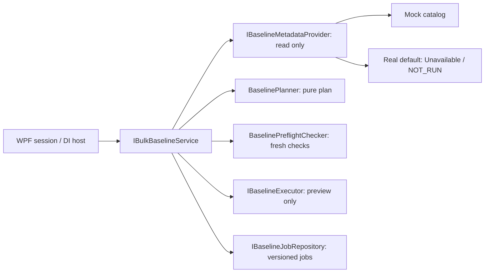

# Task 19 — Bulk Baseline Manager architecture

Bu görev planlama, salt okunur ön kontrol, yürütme önizlemesi ve job saklama altyapısını ekler. **Gerçek baseline oluşturma yoktur.** `IBaselineExecutor` yalnız `PreviewAsync` sunar; write/execute/create metodu, yazmayı açan ayar veya onay atlama yolu eklenmemiştir. Tüm yürütme sonuçları `NotRun` (`NOT_RUN`), `IsPreview=true`, `WriteAttempted=false`, `CreatedBaselineId=null` olur. `Preflight.Passed=true` olsa bile `CanExecute=false` kalır.

## Mevcut mimariyle ilişki

Repository incelemesinde `IDoorsAdapter` adında ortak bir arayüz bulunmadı. Mevcut portlar `IDoorsHierarchyReader`, `IRequirementReader`, `ILinkReader` ve ilgili write gateway/confirmation sözleşmeleridir. Bunlar korunmuştur; tek bir yeni adaptör arayüzüne taşınmamıştır. `MockDoorsAdapter` mevcut read portlarını uygulamaya devam eder ve ek olarak `IBaselineMetadataProvider` uygular.

Baseline comparison, traceability graph, processing/batch, quality rule engine, export, native COM/DXL, mevcut write onayları ve WPF MVVM akışı değiştirilmemiştir. `ClientSession` eski constructor imzasını korur ve yeni overload üzerinden `IBulkBaselineService` alabilir. `BulkBaselines` özelliği Mock ve Real session'larda bulunur. Bu görevde yeni WPF ekranı veya CLI komutu eklenmez; sonraki ekran görevleri bu servisi async kullanabilir.



## Sözleşmeler ve katmanlar

| Sözleşme / sınıf | Görevi |
| --- | --- |
| `IBulkBaselineService` / `BulkBaselineService` | CreatePlan, Preflight, PreviewExecution ve GetJob orkestrasyonu; correlated log; otomatik retry yok |
| `IBaselineMetadataProvider` | Stabil kimlik/yol, structured current version, formal modül türü, izin/kilit gözlemleri ve mevcut sürüm listesini read-only okuma |
| `BaselinePlanner` | Metadata snapshot'larından değiştirilemez plan üretme; adaptör/COM/depo bağımlılığı yok |
| `BaselinePreflightChecker` | Planı yeni metadata gözlemleriyle karşılaştırma; native çağrı ve lock acquisition yok |
| `IBaselineExecutor` / `ReadOnlyBaselineExecutor` | Plan ve ona ait ön kontrolden yalnız NOT_RUN yürütme önizlemesi üretme |
| `IBaselineJobRepository` / `InMemoryBaselineJobRepository` | Değiştirilemez job snapshot'ları, atomic optimistic revision kontrolü, bounded session storage |
| `UnavailableBaselineMetadataProvider` | Doğrulanmış native metadata implementasyonu yokken bunu açıkça raporlama; COM aktivasyonu yok |

Native metadata/creation API isimleri varsayılmamıştır; yeni DXL scripti yoktur. Real bağlantıda mevcut modül içeriğini okuyarak baseline sürümü/izinleri/kilitleri tahmin eden bir fallback de yoktur. Gerçek DOORS 9.5/9.7 baseline metadata ve creation doğrulaması **NOT_RUN** durumundadır.

## Modeller ve kimlikler

`BulkBaselineRequest`, `BaselineJob`, `BaselinePlan`, `BaselinePlanItem`, `BaselineExecutionResult`, `BaselineModuleResult`, `BaselinePreflightResult` public modellerdir. Ek modeller: `BaselineVersion`, `BaselineModuleReference`, `BaselineModuleSelection`, `BaselineModuleMetadata`, `BaselinePreflightItemResult`.

- `BaselineType`: yalnız `Major`, `Minor`.
- `BaselineMode`: yalnız `Independent`. Gelecekte BaselineSet ayrı capability/koordinasyon ve onay tasarımıyla eklenebilir; bugün enum'a cast edilen başka değer reddedilir. Independent plan bir baseline set veya native transaction değildir.
- `BaselineModuleReference`: `RepositoryId`, opaque stabil `ModuleId` ve `CanonicalFullPath`. Path native kimlik yerine kullanılmaz; native ID path'ten hesaplanmaz. Real çağıran kimlikleri doğrulanmış bir kaynaktan sağlamalıdır. Path case/Unicode karakterleri korunur; `/`, göreli yollar, `..`, yinelenen slash ve canonical olmayan trailing slash reddedilir. Sessiz rename/path düzeltmesi yoktur.
- Job tek repository ile sınırlıdır. Seçimde hem ModuleId hem canonical path benzersiz olmalıdır. Modül sayısı 1–10000; koleksiyonlar defensive copy ve read-only olarak tutulur.
- `CurrentVersion` ve `ExpectedVersion`: major/minor/suffix ayrı alanlardır; görünen etiket veya Object Number parse edilmez. Sağlayıcı currentVersion için otoritatif modül baseline sayacını sağlamalıdır. Çalışan client sürümü veya baseline display label bunun yerine geçmez.
- Plan önerisi: Major → `(major + 1, 0, effectiveSuffix)`; Minor → `(major, minor + 1, effectiveSuffix)`. Bu yalnız inceleme önerisidir; server tarafından ayrılmış veya doğrulanmış bir baseline numarası değildir. Version bound aşımı modül bazında Blocked döner.
- `Suffix`, `Annotation` job seviyesindedir. `BaselineModuleSelection` nullable override alanlarıyla genişletilebilir: `null` inherit eder, `""` açık boş değerdir. Annotation Unicode ve CR/LF/tab içerebilir; annotation/suffix DXL koduna gömülmez.
- Plan item ve module result: JobId, Module/ModuleId, CurrentVersion, ExpectedVersion, Suffix, Annotation, Status, FailureReason. Job ayrıca Revision, CreatedAtUtc, UpdatedAtUtc taşır; execution/module sonuçlarında StartedAtUtc/CompletedAtUtc vardır. **Execution timestamps burada önizleme adımının süresidir; baseline oluşturma kanıtı değildir.**

## Plan → ön kontrol → önizleme

1. `CreatePlanAsync` metadata'yı sırayla ve token ile okur, saf planner'ı çalıştırır, yeni JobId/revision 0 ile job kaydeder. Native okuma istisnası yalnız ilgili modülü Unavailable yapar; mesaj içeriği loga/sonuca sızdırılmaz. Diğer modüller planlanmaya devam edebilir. Cancellation kısmi plan yayınlamaz.
2. `PreflightAsync` metadata'yı yeniden okur. Exact repository/native ID/canonical path binding, formal modül türü, currentVersion değişimi, creation permission, lock availability ve expectedVersion çakışmasını kontrol eder. Version listesi tam değilse çakışma yokluğu kanıtlanmış sayılmaz. Failed → Blocked, Unknown → Unavailable. Yeni metadata plan oluşturma zamanından önce, gelecekte veya beş dakikadan eski olamaz.
3. Başarılı ön kontrol yazma yetkisi, kullanıcı onayı, kilit tutma veya numara rezervasyonu değildir. Eşzamanlı değişiklikler gelecekteki gerçek write öncesinde yeniden kontrol edilmelidir.
4. `PreviewExecutionAsync` ön kontrol olmadan çağrılırsa hata verir. Exact plan ve preflight snapshot binding kontrol edilir. Başarılı modüller dahil tüm sonuçlar NOT_RUN kalır; bloklanan modüllerin gerekçeleri korunur. Tekrar çağrı aynı kayıtlı preview'ı döndürür; executor tekrar çağrılmaz.
5. Yeni `PreflightAsync` önceki preview'ı temizleyip revision artırır. Stale plan currentVersion/path değişmişse yeni plan gerekir; sistem hedefi veya sürümü otomatik değiştirmez.

Job durumları `Planned → PreflightPassed/PreflightBlocked → Previewed` şeklindedir. Ön kontrol tekrar yapılabilir. Plan/preflight aggregate durumlarında Blocked, Unavailable'dan önce raporlanır; modül detayları kaybolmaz. Executed/Succeeded gibi gerçek yazma iddiası taşıyan durum eklenmemiştir.

## DI ve WPF bağlantısı

Console `AddDoorsIntegration` ve WinForms `AddDoorsDesktop`, `TryAdd` ile aşağıdakileri kaydeder:

```csharp
IBaselineMetadataProvider -> UnavailableBaselineMetadataProvider (singleton)
IBaselineExecutor        -> ReadOnlyBaselineExecutor (singleton)
IBaselineJobRepository   -> InMemoryBaselineJobRepository (singleton)
BaselinePlanner / BaselinePreflightChecker (singleton)
IBulkBaselineService     -> BulkBaselineService (transient)
```

Host kayıtları önce yapılabilir veya container üzerinden değiştirilebilir. Yeni servis mevcut read/write portlarını replace etmez. WPF kendi constructor/factory composition yapısını korur: `ClientSession.BulkBaselines` session boyunca aynı depoyu kullanır; yeni overload ile özel servis enjekte edilebilir. Mock session yalnız açık `mock-doors-demo` repository ve katalogdaki `mock-qualified:...` kimlikleri için simülasyon metadata'sı döndürür. Bu kimlik formatı yalnız demo verisidir, gerçek DOORS kimlik formatı değildir.

Mevcut COM işlemleri kendi STA executor/gate/drain mekanizmasını kullanmaya devam eder. Gelecekte metadata portuna bağlanacak COM sağlayıcısı da kendi worker/STA ve cancellation/timeout belirsizliği yönetiminden sorumlu olacaktır; WPF UI thread'inde doğrudan COM çalıştırmamalıdır. `ConfigureAwait(false)` tek başına COM çağrısını worker'a taşımaz.

## Mock kullanım örneği

```csharp
var session = MockDoorsAdapter.CreateSession(logger);
var module = new BaselineModuleReference(
    MockDoorsAdapter.BaselineRepositoryId,
    "mock-qualified:" + MockDoorsAdapter.ModulePath,
    MockDoorsAdapter.ModulePath);
var request = new BulkBaselineRequest(
    new[] { new BaselineModuleSelection(module) },
    BaselineType.Minor, BaselineMode.Independent,
    suffix: "review", annotation: "Offline plan review");

var job = await session.BulkBaselines.CreatePlanAsync(request, token);
job = await session.BulkBaselines.PreflightAsync(job.JobId, token);
job = await session.BulkBaselines.PreviewExecutionAsync(job.JobId, token);
// job.Execution.Status == NotRun; WriteAttempted == false
```

## Depolama, hata ve cancellation sınırları

Varsayılan depo **kalıcı değildir**: process/session kapanınca job'lar kaybolur. Varsayılan 1000 job; kapasitede hata verir, sessiz eviction yapmaz. Repository portu gelecekte durable implementation ile değiştirilebilir. `AddAsync` initial revision 0 ister; `TryUpdateAsync` expectedRevision ve bir sonraki revision ile atomik commit yapar. Concurrent update kaybeden taraf `BulkBaselineFailed` (56) alır; yeniden okuma/inceleme gerekir, otomatik retry yoktur. Default memory store exact immutable plan instance'ını korur; kalıcı sağlayıcı logical identity/revision invariants'ını sağlamalıdır.

Metadata provider, repository ve executor hatalarında otomatik tekrar deneme yapılmaz. Cancellation kooperatiftir; provider'ın token'ı işlemesi gerekir. Gelecekteki senkron COM işlemini zorla iptal ettiği iddia edilmez. Job logları correlation JobId, adım ve durum/sayı tutar; annotation, suffix, module path/ID veya native istisna mesajı loglanmaz. Provider'ın açıklayıcı FailureReason alanı UI/veri olarak kalır; sağlayıcı oraya secret koymamalıdır. Repository hatası/concurrency conflict başarılı job sonucu gibi sunulmaz.

Gelecekte gerçek creation eklemek ayrı write sözleşmesi, exact plan/version-bound açık kullanıcı onayı, fresh preflight, audit, native API/protokol doğrulaması ve timeout sonrası outcome-unknown/idempotency politikasını gerektirir. Task 19 bunların yerine geçen bir güvenli write capability iddiasında bulunmaz.

## Değişen dosyalar

| Dosya | Değişiklik |
| --- | --- |
| `src/DoorsIntegration.Core/BulkBaselineContracts.cs` | Dört public sözleşme |
| `src/DoorsIntegration.Core/BulkBaselineModels.cs` | Request/job/plan/preflight/preview, kimlik, metadata ve enum modelleri |
| `src/DoorsIntegration.Core/BaselinePlanning.cs` | Saf planner ve ön kontrol |
| `src/DoorsIntegration.Core/BulkBaselineInfrastructure.cs` | Unavailable provider, read-only executor, memory repository |
| `src/DoorsIntegration.Core/BulkBaselineService.cs` | Orkestrasyon, cancellation, log, optimistic concurrency |
| `src/DoorsIntegration.Core/Errors.cs` | Additive `BulkBaselineFailed = 56` |
| `src/DoorsIntegration.Console/ServiceCollectionExtensions.cs` | Additive, override edilebilir DI kayıtları |
| `src/DoorsIntegration.Desktop/ServiceCollectionExtensions.cs` | Additive DI kayıtları |
| `src/DoorsIntegration.Wpf/Services/ClientSession.cs` | Eski constructor korunarak BulkBaselines dependency'si |
| `src/DoorsIntegration.Wpf/Services/MockDoorsAdapter.cs` | Simülasyon metadata portu ve session composition |
| `tests/DoorsIntegration.Tests/BulkBaselineTests.cs` | Plan/preflight/lifecycle/DI/mock/concurrency/read-only testleri |
| `README.md`, bu belge, `docs/VALIDATION.md` | Mimari, kullanım, build ve test kanıtı |

Yeni proje veya NuGet bağımlılığı yoktur. SDK-style projeler yeni `.cs` dosyalarını otomatik derler. Settings, watchdog tercihi, ikon, native DXL scriptleri ve mevcut write confirmation ekranları değiştirilmemiştir.

## Build ve test

Windows, .NET Framework 4.8 reference assemblies ve uyumlu .NET SDK/MSBuild gerekir. Repository kökünde:

```powershell
$env:DOORS_TEST_MODE = 'disabled'
dotnet restore DoorsIntegration.sln -p:Platform=x86 --configfile NuGet.Config
dotnet build DoorsIntegration.sln -c Release -p:Platform=x86 --no-restore
dotnet test tests/DoorsIntegration.Tests/DoorsIntegration.Tests.csproj -c Release -p:Platform=x86 --no-build --no-restore --settings tests.runsettings --filter 'FullyQualifiedName~BulkBaselineTests' -- RunConfiguration.TargetPlatform=x86
```

x64 için aynı üç komutta Platform/TargetPlatform `x64` seçilir. Tüm regresyonlar için `--filter` kaldırılır. Offline mevcut cache ortamında doğrulama, önceki görevlerle aynı `artifacts/SmokeBuildHost` içindeki SDK 5.0.416 kullanılarak yapıldı; yeni SDK'ların offline NuGet audit davranışı için güvenlik ayarı değiştirilmedi. Test kanıtı ve sayıları `docs/VALIDATION.md` altındadır. `bin/<architecture>/Release/net48` çıktıları Task 19'u içerir; önceki tarihli ZIP release'ler bu görevden önceki sürümlerdir ve yeniden yazılmaz.

## Kabul kriterleri

- Dört sözleşme ve istenen yedi ana model public; Major/Minor ve yalnız Independent kabul edilir.
- Modül identity'si repository + stabil ModuleId ile saklanır; canonical path ayrıca korunur. Yalnız path veya yalnız ID eşleşmesiyle farklı metadata kabul edilmez.
- Job defaults ve explicit empty/per-module overrides ayrıdır; Unicode annotation korunur.
- Pure planner, fresh preflight, preview executor ve repository ayrı bağımlılıklardır.
- Current version değişimi, sürüm çakışması, bilinmeyen izin/kilit, eksik version listesi ve erişilemeyen modüller açık raporlanır.
- Ön kontrol geçse de creation kapalı; tüm module/job execution sonuçları NOT_RUN, sıfır write ve null created-baseline-ID taşır.
- Eski constructor'lar/servisler ve DI override davranışı korunur; Mock/Real WPF session'ları çözümlenir.
- İki concurrent preflight commit'inden yalnız biri kazanır; retry yoktur. Cancellation kısmi job veya sahte başarı yayınlamaz.
- x86/x64 build ve regresyon testleri geçer; gerçek 9.5/9.7 baseline testi ortam yokken NOT_RUN kalır.
