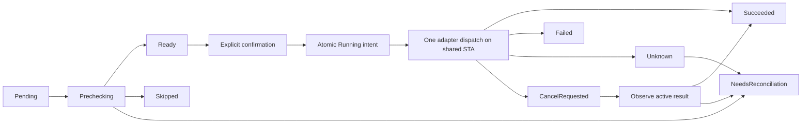

# Task 24 — Bulk baseline job orchestrator

`BulkBaselineJobRunner`, WPF'den bağımsız .NET Framework 4.8 Core servisidir. Task 22 preflight ve Task 23 onay/COM-DXL adapter portlarını kullanır. Modüller sırayla işlenir; native adapter mevcut tek, kalıcı STA COM kuyruğunu kullanır. Runner COM/UI handle'ı taşımaz. Disk I/O ve koordinasyon background task'tadır; confirmation portunun UI dispatcher sorumluluğu host'a aittir.

**Real yazma varsayılan olarak kapalıdır.** Native preflight/next-version sağlayıcıları ve DOORS 9.5/9.7 deployment davranışının doğrulanması hâlâ bekler. Create confirmation ve yeni retry confirmation default reject'tir. Gerçek DOORS verisi değiştirilmedi; yeni DXL perm/script eklenmedi. WPF progress ekranı, Settings ve mevcut servisler korunur.

## API ve kullanım

| Sözleşme / tip | Görev |
|---|---|
| `IBulkBaselineJobRunner` | Create, Open/recover, Run/resume, explicit Retry |
| `BulkBaselineJobRecord` | Immutable JobId/revision/input fingerprint, policy/source/context, timestamps, elapsed ve modules |
| `BulkBaselineJobModule` | Stable repository/module ID + canonical path, original current/expected version, effective suffix/annotation, status/reason, attempt/operation IDs, intent ve sticky success |
| `IBulkBaselineJobJournal` / lease | Exclusive ownership ve atomic checkpoint |
| `FileBulkBaselineJobJournal` | Bounded, checksum kontrollü kalıcı dosya journal'ı |
| `IBaselineJobStateVerifier` | Exact target için read-only metadata/existence/context kanıtı |
| `BaselineJobStateVerifier` | Mevcut metadata ve preflight-state portlarından kanıt üretir |
| `IBulkBaselineRetryConfirmation` | Önceki hata + yeni kanıt/fresh plan için ayrı operatör onayı |
| `IProgress<BulkBaselineJobProgress>` | Snapshot, current module, toplam/başarılı/settled sayıları, elapsed ve hata bilgisi |

Console/Desktop `AddDoorsIntegration()` yeni portları `TryAddSingleton` ile kaydeder. Host önceden özel sağlayıcı kaydedebilir. Task 19 `BaselineJob`, `IBaselineJobRepository`, preview executor ve Task 23 `IBaselineExecutionService` imzaları korunur. Runtime journal yeni `BulkBaselineJobRecord` tipini kullanır; eski bellek repository'si durable storage değildir.

```csharp
var runner = provider.GetRequiredService<IBulkBaselineJobRunner>();
var preflight = provider.GetRequiredService<IBulkBaselinePreflightService>();
var plan = await preflight.CreatePlanAsync(request, cancellationToken);
var job = await runner.CreateAsync(plan, cancellationToken);
// JobId'yi saklayın; restart'ta aynı iş için yeni job üretmeyin.
var progress = new Progress<BulkBaselineJobProgress>(p =>
    ShowProgress(p.JobId, p.CurrentModule?.ModuleId,
        p.CurrentModule?.Status, p.CurrentModule?.FailureReason,
        p.Settled, p.Total, p.Elapsed));
job = await runner.RunAsync(job.JobId, progress, cancellationToken);

// Yeni uygulama instance'ında aynı journal directory + JobId:
job = await runner.OpenAsync(savedJobId, cancellationToken);
job = await runner.RunAsync(savedJobId, progress, cancellationToken);

// Failed/Skipped/uncertain satır için yalnız explicit retry:
job = await runner.RetryAsync(savedJobId, moduleId, progress, cancellationToken);
```

Run, önceki onayı yeniden kullanmaz. Her dispatch fresh plan ve explicit create confirmation ister. Retry ayrıca `IBulkBaselineRetryConfirmation` üzerinden onay alır; review, önceki başarısız modül snapshot'ını ve yeni kanıt/planı içerir. Salt okunur UI modu host confirmation'ında korunmalıdır. Default kayıtlar yazma açmaz.

## Status ve işlem sırası

Status enum: **Pending, Prechecking, Ready, Running, Succeeded, Skipped, Failed, Unknown, CancelRequested, NeedsReconciliation**. Legacy enum'lar değiştirilmedi. Bir modülün Succeeded olması bütün job'ın bittiği anlamına gelmez; final job status bütün satırlardan hesaplanır.



Başlangıç planı 1–10000 modüllük immutable input'a çevrilir. Effective suffix/annotation override'ları, original current/expected version, module ID/path, database/user/source, type, policy ve timeout/age sınırları fingerprint'e bağlıdır. Yeni proposal'a otomatik retarget yoktur. Başlangıçta hedefi bilinmeyen blocked/skipped satıra aynı job'da tahmini hedef atanmaz; yeni dry-run/job gerekir.

Her aday için yürütme sırası:

1. Prechecking checkpoint; exact expected baseline için read-only metadata, existence ve context doğrulaması.
2. Yeni tek-modüllük preflight; journal'ın original module/current/expected/suffix/annotation/database/user/source bilgileriyle karşılaştırma.
3. Ready checkpoint; explicit confirmation. Retry ise ayrıca retry review onayı.
4. Onaydan **sonra yeniden** exact target sorgusu ve plan revalidation. Dialog öncesi absence kanıtı tekrar kullanılmaz.
5. Yeni attempt ID/count, precondition, UTC start ve **WriteMayHaveOccurred=true** içeren Running intent **dispatch'ten önce** atomik kaydedilir. Bu olası dispatch kaydıdır, native create kanıtı değildir.
6. Tek kullanımlık capability ile yalnız bir adapter çağrısı. Native çağrı mevcut STA kuyruğundadır; bir sonraki modül bekler. Intent/audit yazılamazsa dispatch yapılmaz.
7. Her module completion atomik checkpoint olur. Unknown ayrı checkpoint/progress olarak görünür, ardından NeedsReconciliation yazılır. Completion save başarısızsa sonraki modüle geçilmez; önceki Running/CancelRequested intent recovery için kalır.

ContinueOnError yalnız bilinen Failed/Skipped sonuçlardan sonra devam eder. StopOnFirstError kalan uygun satırları Skipped yapar. **İki policy de Unknown/NeedsReconciliation sonrasında durur.** Başka çözülmemiş modül varken farklı modüle retry başlatılmaz. Başarılı baseline'lar otomatik geri alınmaz; batch transactional değildir.

## Atomik journal

Varsayılan dizin `%LOCALAPPDATA%\DoorsIntegration\baseline-jobs`; `BulkBaselineJournalOptions(directoryPath, maxJournalBytes)` ile değişebilir. Restart aynı dizin ve JobId'yi kullanmalıdır. Default limit 64 MiB (konfigürasyon 1 KiB–512 MiB), modül limiti 10000, modül attempt limiti 1000'dir.

Her job için `JobIdN.json` ve `JobIdN.lock` vardır. `FileShare.None` lease aynı işi iki runner/process'in sahiplenmesini engeller. Singleton coordinator aynı anda yalnız bir job çalıştırır; native queue/global operation gate de COM dispatch'i korur. Distributed exactly-once garantisi verilmez.

Checkpoint aynı dizindeki benzersiz `.tmp` dosyasına bounded serialization ile yazılır, WriteThrough ve `Flush(true)` uygulanır. İlk publish `File.Move`, sonraki checkpoint `File.Replace` kullanır. Delete+move fallback yoktur. Atomic replace desteklenmiyorsa veya disk doluysa iş kapalı kalır. Yalnız o yazımın sahip olduğu temporary dosya temizlenir; orphan temp otomatik başarı kaydı sayılmaz.

Schema=1 envelope, SHA256 payload checksum, immutable input fingerprint ve monoton revision kontrol edilir. Corrupt/truncated/foreign-job/oversized/uyumsuz journal sıfırlanmaz, yeni iş gibi çalıştırılmaz. Checksum corruption kontrolüdür; dosya sahibine karşı authentication değildir. Yerel atomic-replace destekli storage beklenir; donanım/power-loss veya network filesystem için mutlak durability iddia edilmez.

Snapshot'ın tamamı her checkpoint'te değiştirilir; journal append-only attempt history değildir. Son sonuç, attempt count/ID, son COM operation ID ve verification gözlemi saklanır. Checkpoint logları job/revision/index/status/attempt/operation ID içerir; annotation/raw exception text loglanmaz. Büyük seçimlerde checkpoint I/O maliyeti seçim büyüklüğüyle artar. UI observer/log sink hatası committed journal'ı veya başarı sonucunu silemez. Approval audit hatası dispatch'i engeller.

## Crash/restart ve idempotency

| Kalıcı durum | Recovery |
|---|---|
| Pending / hiç denenmemiş CancelRequested | Sonraki explicit Run fresh preflight ve approval ile devam edebilir |
| Prechecking / Ready | Dispatch intent yok; Pending'e döner, eski onay kullanılmaz |
| Running / dispatch sonrası CancelRequested | Önce Unknown checkpoint; expected target read-only sorgulanır |
| Olası önceki write + exact matching baseline | Succeeded gözlemi; create tekrarlanmaz |
| Olası önceki write + absent/unknown/conflict | NeedsReconciliation; normal Run otomatik retry etmez |
| Succeeded + matching target | Succeeded korunur; adapter çalıştırılmaz |
| Succeeded + missing/inaccessible/conflicting target | NeedsReconciliation; **EverSucceeded sticky marker korunur**, aynı job'da yeniden oluşturma yasaktır |
| Failed / Skipped | Normal Run tekrar çalıştırmaz; ayrı Retry gerekir |

Native create ve journal checkpoint tek bir transaction değildir. Create başarılı olup checkpoint kaydedilemezse durable Running intent bu pencereyi korur. Önceki olası write için exact module/version/annotation/creator gözlemi desired-state kanıtıdır; kesin nedensellik veya ownership iddiası değildir. Henüz denenmemiş bir hedefin mevcut olması otomatik Succeeded sayılmaz; NeedsReconciliation olur. JobId/dizini silip yeni job açmak recovery yerine geçmez.

## Cancellation ve progress

Caller token yeni modül/dispatch başlamasını engeller. Queue'da bekleyen capability de native dispatch öncesinde token/expiry kontrolünden geçer. Aktif adapter çağrısına iptal edilebilir token verilmez; iptal COM'u güvenle abort etme iddiası taşımaz. İptal fark edilince current module CancelRequested ve job flag atomik kaydedilir; aktif task gözlenmeye devam edilir. Yaklaşık 500 ms heartbeat elapsed/progress üretir.

Aktif çağrı başarılı biterse o modül Succeeded; başlanmamış satırlar CancelRequested kalır. Timeout/COM belirsizliği NeedsReconciliation olur. Task 23 late-completion cleanup/busy gate korunur; runner COM handle dispose etmez. Sonraki explicit Run yalnız hiç denenmemiş iptal satırlarını yeni inceleme/onayla sürdürebilir. Denenmiş belirsiz satır Retry/reconciliation ister.

Elapsed, Stopwatch ile kümülatif aktif koordinasyon süresidir; uygulamanın kapalı kaldığı süre dahil değildir. UTC start/completion/success-observation ayrıca saklanır. Progress immutable snapshot'tır ve UI, CLI veya testten kullanılabilir. Journal hatası `BulkBaselineJournalException` / additive `BulkBaselineJobFailed=60` üretir; son disk kaydı okunup uzlaştırılmadan kör retry yapılmamalıdır.

## Retry şartları

`BaselineJobStateVerifier` metadata/collision sonucunu ve ardından exact module/state/context kanıtını kontrol eder. ExistsMatching için stable identity/version, annotation ve creator eşleşmeli; post-metadata state de hedefi mevcut görmelidir. Eksik, stale, future-dated veya yanlış source/context Unknown'dur.

**AbsentAuthoritatively, negative baselineExists değildir.** Complete metadata, exact-target visibility/Free kanıtı, temiz/unlocked/closed veya read-only session, reliable content/ACL/lock revisions ve fresh session bilgisi gerektirir. Metadata state okunurken eskirse reddedilir. Aktif/dirty/unknown state retry açmaz. Default native sağlayıcı bunu henüz kanıtlayamadığından Real retry kapalıdır.

Retry sırası: fresh metadata/existence → fresh unchanged-target preflight → operatör retry onayı → explicit write onayı → **yeniden** exact target sorgusu → yeniden preflight validation → durable yeni intent → tek dispatch. Persisted eski verification yetki değildir. Hedef ve annotation immutable kalır; yeni proposal'a yükseltilmez.

Task 23 native quarantine'ı için dar kapsamlı ek yol vardır: yalnız durable runner'ın onaylardan sonra ürettiği fresh authoritative absence içeren capability; aynı JobId/module/version/annotation/database/user ile ve **executor busy değilken** ilgili quarantine'ı yeniden hazırlayabilir. Farklı job/source, stale proof veya hâlâ aktif COM çağrısı reddedilir. Tek başına negative reconciliation/normal confirmation bunu açmaz. Native release/script compatibility kontrolleri değişmedi.

## Dosyalar, build ve test

Yeni Core dosyaları: `BulkBaselineJobModels.cs`, `FileBulkBaselineJobJournal.cs`, `BaselineJobStateVerifier.cs`, `BulkBaselineJobRunner.cs`. `BaselineExecution.cs` eski constructor'ları koruyarak stable runtime JobId, cancellation-aware dispatch ve retry-proof bağını ekler. `Errors.cs` code 60 ekler. `DxlBaselineExecutionAdapter.cs` yalnız onaylı exact drained retry yoluyla genişletildi. Console/Desktop DI kaydı güncellendi.

Yeni test dosyaları: `BulkBaselineJobTestDoubles.cs`, `BulkBaselineJobRunnerTests.cs`, `BulkBaselineJobJournalTests.cs`, `BulkBaselineJobVerificationTests.cs`. `BaselineExecutionProtocolTests.cs` içine 5 fake-transport case eklendi. **57 yeni offline case:** runner 25, journal 9, verifier 18, adapter 5. Mock server uygulama dışında yaşayan DOORS durumunu temsil eder; testte runner/journal/adapter instance'ları yeniden oluşturulur. Bu bir gerçek OS process kill veya canlı DXL doğrulaması değildir.

Son Release doğrulaması: **x86 ve x64 için ayrı ayrı 0 build hata/uyarı; 1412 Passed, 15 NOT_RUN, 1427 total, 0 Failed**. Focused scope 107 Passed + 8 NOT_RUN'dır (mevcut baseline execution/metadata regresyonları dahil). Eski 15 canlı senaryo default NOT_RUN kalır; gerçek ortam/explicit consent yönergeleri [BASELINE-EXECUTION.md](BASELINE-EXECUTION.md) içindedir. Gerçek DOORS state/next-version ve 9.5/9.7 runtime kabulü önceki görevden açık bağımlılıktır.

Windows + .NET Framework 4.8 Developer Pack ve mevcut SDK 5.0.416 build host ile repo kökünden:

```powershell
$env:DOTNET_CLI_HOME = Join-Path $PWD '.cli'
$env:DOORS_TEST_MODE = 'disabled'
Push-Location artifacts/SmokeBuildHost
foreach ($arch in @('x86', 'x64')) {
    dotnet restore ../../DoorsIntegration.sln -p:Platform=$arch --packages ../../.packages --configfile ../../NuGet.Config --ignore-failed-sources
    if ($LASTEXITCODE -ne 0) { throw 'Restore failed' }
    dotnet build ../../DoorsIntegration.sln -c Release -p:Platform=$arch --no-restore
    if ($LASTEXITCODE -ne 0) { throw 'Build failed' }
    dotnet test ../../tests/DoorsIntegration.Tests/DoorsIntegration.Tests.csproj -c Release -p:Platform=$arch --no-build --no-restore --settings ../../tests.runsettings --logger "trx;LogFileName=bulk-baseline-job-full-$arch.trx" --results-directory ../TestResults -- RunConfiguration.TargetPlatform=$arch RunConfiguration.TestSessionTimeout=360000
    if ($LASTEXITCODE -ne 0) { throw 'Tests failed' }
}
Pop-Location
```

Focused filter: `FullyQualifiedName~BulkBaselineJob|FullyQualifiedName~BaselineExecution`. Kanıt: `docs/VALIDATION.md`, `artifacts/TestResults/bulk-baseline-job-*.trx`, `artifacts/BulkBaselineJob/verification.json`. Eski release ZIP'leri değiştirilmedi; güncel binaries `bin/x86/Release/net48` ve `bin/x64/Release/net48` dizinlerindedir.
