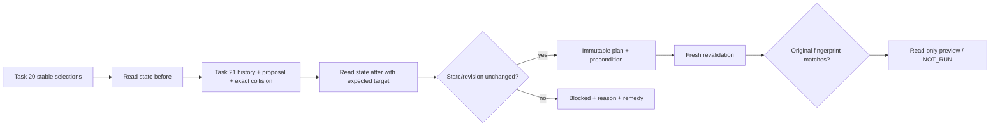

# Task 22 — Bulk baseline preflight and dry run

`BulkBaselinePreflightService` / `IBulkBaselinePreflightService`, Task 20 seçimlerinden gelen stabil modül referanslarıyla read-only plan üretir; Task 21 metadata/proposal/collision sonuçlarını kullanır. WPF **Bulk baseline / Dry run** sekmesi eklendi. Önceki sekmelerin sırası korunur.

**Dry Run hiçbir baseline oluşturmaz.** Servisin state portunda yalnız ReadAsync vardır; save/discard/unlock/edit/ACL metodu yoktur. Sonuçta `CanExecute=false`, `WriteAttempted=false`, `LockChanged=false`, `ModuleContentChanged=false` sabittir. Ready, yalnız o andaki read-only uygunluk gözlemidir; kullanıcı onayı veya yazma yetkisi değildir.

## Native kapsam

Mock adapter üzerinde bütün kontroller ve revalidation akışı çalışır. Real DOORS için henüz doğrulanmış read-only create/modify/lock/session/revision state reader yoktur; varsayılan **UnavailableBaselinePreflightStateReader** bunu açıkça raporlar ve modülü Blocked yapar. Native next-version çözümlemesinin Task 21'deki doğrulama sınırı da korunur. Bilinmeyen erişim, kilit, oturum, revision veya hedef sürüm Ready sayılmaz. Yeni native perm veya DXL scripti eklenmemiştir; gerçek 9.5/9.7 kabulü NOT_RUN'dır. Bu sınırlama bir başarılı native preflight gibi sunulmaz.

## Katmanlar ve modeller

| Tip | Sorumluluk |
| --- | --- |
| `BulkBaselinePreflightRequest` | Immutable BulkBaselineRequest + ExecutionPolicy, target/connection/timeout, yaş sınırları |
| `IBaselinePreflightStateReader` | Yalnız read-only existence/type/access/edit/lock/session/dirty/revision/input/target kanıtı |
| `BaselinePreflightProbe` | Exact request/selection/type/suffix/annotation ve isteğe bağlı ExpectedVersion binding |
| `BaselinePreflightFacts` / `BaselinePreflightObservation` | Immutable durum, kaynak/evidence ve UTC gözlem zamanı |
| `BulkBaselineDryRunPlan` / `BulkBaselineDryRunItem` | ModuleId, FullPath, CurrentVersion, ExpectedVersion, Status, Reason, Warning, RecommendedResolution, precondition |
| `BaselinePrecondition` | Versioned SHA256 fingerprint, request hash, immutable state, metadata hash ve zaman |
| `BaselinePreflightRevalidation` / `BaselineRevalidationItem` | Eski plan + fresh sonuç + PreconditionsMatch/EligibleForPreview; hiçbir write yetkisi yok |
| `IBaselinePreflightClock` | Test edilebilir UTC zaman kaynağı |

Eski Task 19 `IBulkBaselineService` ve draft `BaselinePlanner` korunur. WPF'deki PlanCommand artık yeni Task 22 DryRunAsync akışını kullanır; Task 19 arithmetic'i yeni serviste beklenen native sürüm yerine geçirilmez. ClientSession eski constructor'larını korur, yeni 13 parametreli overload / `BaselinePreflight` dependency'si ekler. Console/Desktop DI kayıtları TryAdd ile host override'larını destekler.

## Kontroller

Her modül için:

1. Exact repository/ModuleId/canonical path ve formal modül türü; existence/read/create/modify erişimleri.
2. Gerçek database identity, mevcut kullanıcı ID'si, **session ID** ve connection epoch. Aynı kullanıcı adıyla açılmış başka oturum mevcut oturum sayılmaz. Bir batch içinde farklı kullanıcı/session/database bağlamları birleştirilmez.
3. Edit modu, lock owner ve exclusive edit durumu. Başka oturumun kilidi → Blocked. Shared edit → Blocked. Kendi exclusive edit'i ancak exact owner user/session eşleşirse kabul edilir. Closed/read-only ve unlocked modül, ancak reader read-only olarak exclusive availability kanıtı sağlarsa koşullu Ready olabilir; **kilit alınmadığı Warning'de belirtilir**. Bu gelecekte lock acquisition başarısını garanti etmez.
4. Unsaved current-session / other-session / unknown → Blocked. Kendi değişiklikleri için ayrı inceleme ve açık save/discard kararı önerilir. Başka oturumun değişiklikleri kaydedilmez veya iptal edilmez; sahibiyle koordinasyon önerilir. Servis bu işlemleri yapamaz.
5. Modül content/history, ACL ve lock revision token'larının güvenilirliği. Eksik veya yalnız görünen baseline numarasına dayanan token güvenilir kanıt değildir. Native reader bunu sağlayamıyorsa Unknown/Blocked döndürmelidir. Unlocked/clean ile owner bilgisi çelişirse InvalidEvidence olur.
6. Major/Minor enum, suffix ve annotation için mevcut syntax/Unicode/uzunluk kontrolleri, ayrıca reader'ın **aynı probe** için verdiği input validity kanıtı. Null override job değerini devralır; boş override açık boş değerdir. Annotation boşluğu warning üretir; otomatik text değişikliği yapılmaz. Gerçek input kuralları varsayımsal native perm ile taklit edilmez.
7. Task 21'den complete/güncel/aynı kaynakta metadata, latest-recorded CurrentVersion ve exact snapshot/module/type/suffix'e bağlı Available proposal. İlk baseline'da CurrentVersion null/None olabilir; explicit next-version proposal gerekir. Native proposal doğrulanmıyorsa arithmetic fallback yoktur.
8. Exact ExpectedVersion collision. Pozitif baselineExists → Blocked. Unknown → Blocked. **AbsentOrUnreadable** tek başına yeterli değildir: son state probe'u aynı expected target için yetkili görünürlük/yokluk kanıtıyla TargetAvailability.Free bildirmelidir. Çelişki veya eksik kanıt → Blocked.

Her Blocked satırın bir ReasonCode, insan tarafından okunabilir Reason ve RecommendedResolution alanı vardır. Çözüm örnekleri: stabil kimliği yeniden keşfetme, gerekli ACL'yi yöneticiye doğrulatma, kilit sahibinin normal yoldan işini bitirmesini bekleme, dirty veriyi sahibinin oturumunda inceleme, API/revision/target kanıtını doğrulama veya yeni plan oluşturma. Force-unlock, otomatik save/discard/downgrade, eski hedefi otomatik yükseltme veya mevcut baseline'ı silme önerilmez.

## Okuma sırası ve fingerprint



Metadata sorgusu, iki state okuması arasına alınır. İçerik, ACL, lock, kullanıcı/session veya connection epoch arada değişirse ChangedDuringRead olur. Edit/lock durumu sorgulamak için bir kilit alıp deneme yapılmaz.

SHA256 uzunluk kodlu binary alanlardan streaming hesaplanır; bütün metadata'yı bir dev string'e birleştirmez. Precondition kapsamı: request ve modül kimliği/path, type/mode, effective suffix/annotation, ExecutionPolicy ve bağlantı ayarları; state/session/owner/revision/permission/input/source evidence; current/latest designations; proposal source/evidence/expected version; exact collision; history satırlarının kimlik/version/annotation/creator/date/existence bilgileri. History hash'i key sırasına göre alınır. Random ObservationId ve okuma timestamp'leri semantic hash'e eklenmez; bunlar her okumada değiştiği için false mismatch üretmez. Gözlem zamanının güncelliği ayrıca kontrol edilir. Plan fingerprint'i PlanId, creation UTC ve ordered item durumlarını da kapsar.

Fingerprint bir imza, lock reservation, authenticated authorization veya veritabanındaki değişiklikleri kendi başına algılayan sihirli token değildir. Content/ACL/lock revision'larının doğruluğu reader sözleşmesidir. Hash değişmeyen sayısal baseline'a rağmen içerik/session/ACL/lock token değişimini yakalar; gerçek adapter bu alanları güvenilir okuyamıyorsa Ready vermez.

## Revalidation ve zaman sınırları

`CreatePlanAsync` yalnız ilk planı üretir. `RevalidateAsync(plan)` her eski Ready modülü yeniden state → metadata → state akışından geçirir. `DryRunAsync(request)` **CreatePlanAsync ardından hemen RevalidateAsync** çağırır; WPF varsayılan akışı budur.

- Yeni bir gözlem ID'si/timestamp aynı semantic durumu tek başına bozmaz.
- State, expected version veya semantic metadata değişirse eski plan Blocked olur; eski hedef yeni hedefle sessizce değiştirilmez. Yeni gözlemdeki hedef yalnız Warning olarak gösterilebilir; yeni plan ve yeniden inceleme gerekir.
- Eski Blocked/Skipped modüller revalidation ile Ready'ye yükseltilmez. Yetki/kilit sorunu çözülse bile yeni plan oluşturulmalıdır.
- Varsayılan plan yaşı 5 dakika, observation yaşı 2 dakikadır. Future timestamp, geriye giden clock veya expiry uygunluk üretmez. Uzun batch sonunda eskiyen erken gözlemler yayınlanırken de bloke edilir; StopOnFirstError bu son aşamada da korunur.
- Revalidation cache'lenmez; her açık yeniden kontrol güncel read çağrıları yapar. Bütün planlar sonlu ve en fazla 10000 modüllüdür. Plan, her modülün tam history DTO'sunu tutmaz; küçük state/precondition ve metadata hash saklar.

**Gerçek baseline writer henüz yoktur.** Gelecekteki writer, kullanıcı onayından sonra her modülün dispatch'inden hemen önce ortak COM STA bağlamında fresh kontrolleri ve exact precondition'ı tekrar doğrulamalıdır; batch başındaki bir read-only kontrolle bütün gelecekteki çağrılar garanti edilemez. Dış kullanıcılar son okuma ile gerçek write arasında değişiklik yapabilir. Task 22 bu TOCTOU aralığını lock değiştirerek kapattığını veya write yetkisi verdiğini iddia etmez.

## ExecutionPolicy ve hata davranışı

`ExecutionPolicy.ContinueOnError` varsayılandır: Blocked modüller listede nedeniyle kalır, diğer modüller kontrol edilir. `StopOnFirstError`: ilk engelden sonrakiler Skipped/uygunluğu okunmamış olarak tutulur. Politikalar actual write için otomatik retry veya onay bypass'ı oluşturmaz.

Native timeout/cancellation uncertainty, operation-busy veya disconnected/COM failure gibi belirsizlikte, ContinueOnError seçili olsa bile kalan modüllere yeni çağrı yapılmaz. Orijinal COM çağrısı/cleanup bitene kadar mevcut UI gate/drain korunur; thread/client öldürme veya otomatik retry yoktur. Normal kayıt-bazlı adapter hatası ContinueOnError altında diğer kayıtlara geçebilir; içerikli exception mesajı loga taşınmaz. Token cancellation kısmi başarılı plan yayınlamaz.

Hiç uygun modül yoksa Summary bunu açıkça söyler. Mixed sonuçlarda Ready/Blocked/Skipped ve revalidation Eligible sayıları ayrı gösterilir. Ready olmayanlar default olarak atlanır; onları zorla dahil eden bir switch eklenmemiştir.

## WPF

Task 20 **Modül seçimi** ekranında seçimleri tamamlayıp **Seçilenlerden Dry Run / Ön kontrol** komutunu kullanın. Uygulama yeni dry-run sekmesine geçer. Aynı sekmede Major/Minor, suffix, annotation ve ExecutionPolicy değiştirilebilir; bunları değiştirmek eski planı temizler.

Tablo: ModuleId, Full path, CurrentVersion, ExpectedVersion, Status, Reason, önerilen çözüm, Warning. Satır seçilince alttaki read-only detayda tam metin ve precondition hash'i gösterilir. PlanId ve plan fingerprint üsttedir. **Ön koşulları yeniden doğrula**, aynı immutable planı yeniden okur; yeni uygunlukla eski hedefi değiştirmez.

Seçim, scope, connection veya baseline input değişimi eski planı temizler. Başarısız yeni plan/revalidation sonrasında önceki eligible görünüm bırakılmaz. Arama/filtre yalnız görünümü değiştirir. Profile dosyası baseline onayı veya preflight proof saklamaz. Global progress/cancellation/busy ve read-only default korunur. Kaynak/servis çağrıları UI dispatcher'ında çalışmaz.

Mock bulk katalogda her klasörde 003 → başka oturum kilidi, 004 → current-session unsaved, 005 → create denied örnekleri vardır. Okunabilen 31 modüllük klasör için varsayılan ContinueOnError sonucu 28 Ready / 3 Blocked; StopOnFirstError ilk iki uygun modülden sonra 1 Blocked / 28 Skipped olur. Bunlar native uyumluluk/izin garantisi değil açık Mock fixture'larıdır.

## Kullanım

```csharp
var request = new BulkBaselinePreflightRequest(
    new BulkBaselineRequest(selectedModules, BaselineType.Minor,
        suffix: "SRR", annotation: "Review candidate"),
    ExecutionPolicy.ContinueOnError);
var result = await session.BaselinePreflight.DryRunAsync(request, token);
var rows = result.Items.Select(item => item.Fresh);
// CanExecute=false, WriteAttempted=false, LockChanged=false

// Ayrı inceleme adımları için:
var plan = await service.CreatePlanAsync(request, token);
var checkedAgain = await service.RevalidateAsync(plan, token);
```

## Değişen dosyalar ve kabul

Yeni Core dosyaları: BulkBaselinePreflightModels.cs, BulkBaselinePreflightService.cs, BaselinePreflightFingerprint.cs, BaselinePreflightStateReaders.cs. Yeni WPF view: Controls/BulkBaselinePreflightView.xaml ve .xaml.cs. Yeni testler: BulkBaselinePreflightTests.cs / BulkBaselinePreflightWpfTests.cs.

Mevcut değişiklikler: Core Errors (additive 58), Console/Desktop DI, WPF ClientSession/MockDoorsAdapter/MockModuleSelectionAdapter, ModuleSelectionViewModel ve view, MainWindow view/event navigation. Eski constructor'lar/servisler korunur. WpfClientTests render testi 8 sekmeyi ve önceki 7 sekmenin sırasını doğrulayacak şekilde güncellendi; önceki test kaldırılmadı. Yeni NuGet veya native COM/DXL API eklenmedi. Settings, icon ve önceki DXL scriptleri değişmedi.

Kabul kapsamı: tüm state/metadata/input kontrolleri; başka oturum kilidi/dirty veride sıfır mutasyon; semantic fingerprint ve before/after sandwich; immutable target ve plan expiry; iki policy + unknown-COM halt; skipped blocked/no promotion; publish-time freshness; NativeUnknown fail-closed; WPF summary/remedy/invalidation/navigation/rendering. Gerçek native state reader/next-version kabulü ayrı doğrulama bekler ve NOT_RUN olarak raporlanır.

Build/test Windows net48 üzerinde, `DOORS_TEST_MODE=disabled` ile:

```powershell
dotnet restore DoorsIntegration.sln -p:Platform=x64 --configfile NuGet.Config
dotnet build DoorsIntegration.sln -c Release -p:Platform=x64 --no-restore
dotnet test tests/DoorsIntegration.Tests/DoorsIntegration.Tests.csproj -c Release -p:Platform=x64 --no-build --no-restore --settings tests.runsettings --filter 'FullyQualifiedName~BulkBaselinePreflightTests|FullyQualifiedName~BulkBaselinePreflightWpfTests' -- RunConfiguration.TargetPlatform=x64
```

x86 için restore dahil bütün architecture değerlerini değiştirin; shared assets restore'larını paralel çalıştırmayın. Bu ortamda mevcut offline SDK 5.0.416 host'u kullanılmıştır. Tam regresyon için filter kaldırılır. Sonuçlar VALIDATION.md'dedir. Görseller artifacts/BulkBaselinePreflight/{x86,x64}/dry-run.png altındadır. Güncel bin çıktıları Task 22'yi içerir; önceki ZIP release'leri değiştirilmemiştir.
