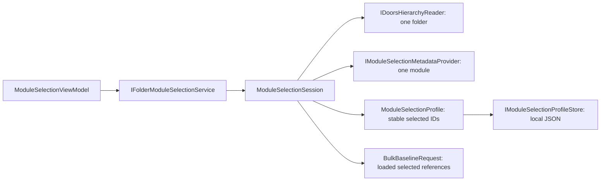

# Task 20 — Multi-folder formal module selection

Task 22 güncellemesi: seçim ekranının plan komutu artık yeni **Bulk baseline / Dry run** akışını açar. Fresh state/metadata/fingerprint kontrolü, execution policy ve çözüm önerileri için [güncel rehber](BULK-BASELINE-PREFLIGHT.md). Aşağıdaki Task 19 preview açıklamaları önceki davranışı anlatır; public legacy servis korunur.

`FolderModuleSelectionService` / `IFolderModuleSelectionService`, bulk baseline için çoklu proje/klasör seçimi sağlar. WPF **Bulk baseline / Modül seçimi** sekmesi mevcut sekmelerin sonuna eklenmiştir; eski tab index'leri ve Workspace ağacı korunur.

Bu özellik salt okunurdur. Seçim, yerel JSON profil kaydı/yükleme ve Task 19 plan önizlemesi DOORS verisini değiştirmez. Baseline oluşturma kapalıdır: `NOT_RUN`, `CanExecute=false`, `WriteAttempted=false`. Bir satırın seçilebilir olması baseline oluşturma izni veya kullanıcı onayı değildir.

## WPF kullanımı

1. Mock/Real kaynağını seçin. Repository bağlamı Mock için `mock-doors-demo`; Real için aynı repository'yi sürekli tanımlayan kurum etiketinizdir. Bu etiket ACL/auth mekanizması değildir; native qualified module ID ayrıca okunur.
2. Tam proje/klasör yolunu yazıp **Klasörü ekle** düğmesine basın. Farklı projelerden kökler eklenebilir. Her satırın **Alt klasörler** checkbox'ı bağımsızdır.
3. **Sonraki grubu yükle**, en fazla 5 klasör sorgusu ve 100 formal modül metadata kaydı ilerletir. Otomatik bütün-ağaç taraması/prefetch yoktur. Ana pencerenin **İptal iste** komutu yüklemeyi iptal eder.
4. Satırlarda ad, canonical full path, tür, erişim, son mevcut baseline, stabil kimlik ve sorun açıklaması gösterilir. Kimliğin tooltip'i tam ID'yi gösterir. `None` mevcut baseline bulunmadığını; `Unavailable` metadata'nın doğrulanamadığını belirtir. İkisi de `0.0` olarak sunulmaz.
5. Checkbox ile tek modül seçin. Kök listesinde satır seçerek **Klasördekileri seç / Klasör seçimini kaldır** komutlarını kullanın. Arama ad, path ve ID üzerinde ordinal case-insensitive çalışır. All / Selectable / Restricted ve **Yalnız seçilenler** filtreleri vardır.
6. **Tümünü seç (görünür)** ve **Görünür seçimi kaldır** yalnız yüklenmiş, aktif filtreye uyan kayıtları etkiler. Klasör bazında seçme de yalnız yüklenmiş kayıtları etkiler; sonradan yüklenecek modüller sessizce seçilmez. **Tüm seçimi kaldır** görünmeyen ve profilden bekleyen seçimleri de temizler.
7. **Profili kaydet (yeni dosya)** ile JSON yazın. Mevcut dosyanın üzerine yazılmaz; yeni isim kullanın. **Profili yükle** aynı repository bağlamında kök/IncludeSubfolders ve istenen kimlikleri geri getirir. Sonraki grupları yükleyerek güncel kimlik/path/erişim doğrulanır.
8. **Seçilenlerden plan önizle (NOT_RUN)** yalnız yüklenmiş, doğrulanmış seçili kimlikleri `BulkBaselineRequest` içine geçirir. Task 19 plan/preflight/preview çalışır. Real Task 19 baseline metadata sağlayıcısı hâlâ Unavailable'dır: seçimde son baseline'ı okumak create preflight'ının tamamlandığı anlamına gelmez.

Kök/IncludeSubfolders/repository değişimi eski cursor ve seçimleri temizler. Bağlantı profili değişince kökler/repository de temizlenir. Tüm service/native çağrıları mevcut `RunToolAsync` worker ve COM STA/gate/drain altyapısından geçer; UI dispatcher'ında COM çalıştırılmaz.

## Mimari ve seçim kapsamı



Cursor UI'den bağımsızdır. Bir repository ve birden fazla canonical root taşır. Hiyerarşi her seferinde `Recursive=false` ile sorgulanır; bounded breadth-first dolaşım cursor'a aittir. Link module, descriptive module ve diğer türler aday yapılmaz. Metadata'sı doğrulanmayan/yetkisiz container üzerinden alt kapsam genişletilmez. Her kökte native erişim kontrolü devam eder; açık kök seçimi ACL atlatmaz.

Folder/path kuyruğu tekilleştirilir; overlapping kökler aynı klasörü tekrar taramaz. Adaylar repository-scoped stabil ModuleId ile de tekilleştirilir. Aynı ID farklı canonical path'lerde gözlenirse ilk satır conflict olarak tutulur ve seçimi kaldırılır; ikinci satır üretilmez, doğru path tahmin edilmez. Path kimlik yerine kullanılmaz. Kimliği okunamayan restricted satırlar gösterilebilir ama seçilemez.

`ModuleSelectionSession`: `Snapshot`, `Query`, `SetSelected`, `SelectFiltered`, `SelectFolder`, `DeselectAll`, `GetSelectedModules`, `CreateProfile`, `LoadNextAsync`. Sonuçlar read-only kopyalardır. Aynı cursor'da eşzamanlı iki LoadNext reddedilir. WPF DataGrid row/column virtualization ve recycling kullanır.

```csharp
var request = new ModuleSelectionRequest(repositoryId, new[] {
    new ModuleSelectionFolder("/Project A/Requirements", true),
    new ModuleSelectionFolder("/Project B/Inputs", false)
});
var cursor = selectionService.Create(request);
var page = await cursor.LoadNextAsync(100, 5, token);
cursor.SelectFiltered(true, new ModuleSelectionFilter("Flight",
    ModuleSelectionAccessFilter.Selectable));
var baselineRequest = new BulkBaselineRequest(cursor.GetSelectedModules());
```

Servis LoadNext varsayılanı 100 modül / 1 klasör, WPF açıkça 100 / 5 kullanır. Çağrı bütçeleri 1–500 modül / 1–50 klasör; varsayılan toplam sınırlar 10000 aday, 10000 klasör ve 128 derinliktir. Servis API'sinde toplam aday/klasör sınırı en çok 100000 olabilir. Profil selected listesi ve Task 19 planı 10000 modülle sınırlıdır. Erişim kısıtı, truncation veya limit `IsIncomplete=true` ve Issues üretir. Görünür kapsam bütün veritabanının görülebildiği anlamına gelmez.

## Kalıcı, yeniden kullanılabilir profil

`ModuleSelectionProfile`: SchemaVersion=1, Name, RepositoryId, Folders[path, IncludeSubfolders], SelectedModules[opaque ModuleId, canonical path], SavedAtUtc. İzin, auth, DXL kodu, write approval veya eski baseline metadata'sı saklanmaz.

`JsonModuleSelectionProfileStore`: UTF-8 JSON, en çok 8 MiB / 256 kök / 10000 selected identity. Unknown/duplicate/missing property, yanlış JSON tipi/şema, duplicate ID/path ve scope dışı kimlik reddedilir. Kayıt CreateNew kullanır. Profil authenticated veya imzalı authorization belgesi değildir.

Restore edilen kimlikler önce pending olur. Ancak güncel metadata aynı repository + stabil ID + exact canonical path gösterir ve satır seçilebilirse seçilir. Aynı path'te yeni ID, taşınmış ID, erişim kaybı veya bulunamayan öğe otomatik eşleştirilmez. Pending sayısı summary'dedir, yeniden kayıtta çözülemeyen kullanıcı niyeti korunur. DeselectAll / ilgili klasör seçimini kaldırma bunu temizleyebilir. Pending kimlikler bulk request'e gönderilmez.

## Gerçek read-only COM/DXL adaptörü

`DxlModuleSelectionMetadataProvider`, ayrı `scripts/dxl/module-selection.dxl` dosyasını mevcut executor üzerinden çalıştırır. Native `qualifiedUniqueID(Item/Module)` ve exact fullName binding kontrol edilir. Current ModuleVersion read-only handle'dan ödünç alınır veya read-only yüklenir. Edit/share açık modül dönüştürülmez. Yalnız sahip olunan handle kapatılır; borrowed handle kapatılmaz. Edit/save/create/delete, ACL değiştirme ve requirement attribute değerlendirmesi yoktur.

Son baseline **son mevcut, silinmemiş baseline** anlamındadır. `getMostRecentBaseline(module,false)` sonucu `baselineExists` ile doğrulanır; major/minor/suffix ayrı okunur, annotation baseline enumeration içinden alınır. Null → None; lookup/metadata/cleanup hatası → Unavailable. Enumeration 10000 baseline, annotation 16384 karakterle sınırlıdır. Display versionString parse edilmez.

Native API declarations reviewed against primary sources: [IBM DXL Reference Manual 9.7.2](https://www.ibm.com/docs/en/SSYQBZ_9.7.2/com.ibm.doors.requirements.doc/topics/dxl_reference_manual.pdf) (getMostRecentBaseline, baseline fields/enumeration, isRead, ModuleVersion/data/load) ve [IBM DXL Reference Manual 9.2](https://download.boulder.ibm.com/ibmdl/pub/software/rationalsdp/documentation/product_doc/DOORS/version_9-2/dxl_reference_manual.pdf) (qualifiedUniqueID/stable identity). [IBM fix list](https://www.ibm.com/support/pages/node/611407), restored-module getMostRecentBaseline sorununu da kaydeder; bu nedenle dönen baseline'ın varlığı ayrıca kontrol edilir. Bu declaration incelemesi runtime doğrulaması değildir: canlı **DOORS 9.5/9.7 kabulü NOT_RUN**. Yeni COM method adı eklenmemiştir.

Wire protocol request ID/path/frame, exact enum token, sürüm alanları ve cleanup kontrol edilir. LF ve Windows CRLF kabul edilir. Escaping slash/tab/CR/LF ile sınırlıdır. Yanlış escape, trailing record, mismatched path/ID, okunabilir satırda kimlik yokluğu veya failed-cleanup çelişkisi reddedilir.

## Cancellation, timeout, hata

Her folder/module çağrısından önce cancellation kontrol edilir. Bir kayıt doğrulanmadan commit edilmez. Önceki tamamlanmış kayıtlar korunur; WPF native drain sonrasında bunları gösterir. Otomatik sonraki sayfa yükleme yoktur.

Native timeout/failure cursor'ı durdurur; otomatik retry/diğer native çağrı başlatılmaz. Soft timeout'ta orijinal COM çağrısı ve late-result cleanup mevcut gate/operation üzerinden tamamlanır; zorla COM iptali/thread öldürme/server kapatma yoktur. WPF busy/drain bitmeden yeni işleme izin vermez. Kullanıcı tanılama sonrasında açık Restart ile yeni read-only cursor başlatabilir.

Provider'ın domain erişim sonucu satır bazında raporlanır. Exception mesajı/requirement içeriği loglanmaz; exception type ve AutomaticRetry=False yazılır. Issues hangi path'in kısıtlı olduğunu gösterir. Bilinmeyen kimlik/erişim başarılı aday sayılmaz.

## DI, dosyalar, test

Console/Desktop DI, TryAdd ile `IFolderModuleSelectionService`, `IModuleSelectionMetadataProvider`, `IModuleSelectionProfileStore`, `ModuleSelectionScriptOptions` kaydeder; host override'ları korunur. WPF ClientSession eski 9 ve Task 19'un 10 parametreli constructor'larını korur; 11 parametreli overload / `ModuleSelection` dependency'si ekler. Task 19 Real `IBaselineMetadataProvider` değişmez.

Yeni dosyalar:

- Core: ModuleSelectionModels.cs, FolderModuleSelectionService.cs, ModuleSelectionProfile.cs.
- Dxl: DxlModuleSelectionMetadataProvider.cs ve scripts/dxl/module-selection.dxl.
- WPF: Services/MockModuleSelectionAdapter.cs, ViewModels/ModuleSelectionViewModel.cs, Controls/ModuleSelectionView.xaml ve .xaml.cs.
- Tests: FolderModuleSelectionTests.cs, ModuleSelectionProtocolTests.cs, ModuleSelectionWpfTests.cs.

Mevcut değişiklikler: Core csproj (framework System.Runtime.Serialization reference), Console/Desktop DI, WPF ClientSession/MockDoorsAdapter/WorkspaceViewModel/MainWindow.xaml ve belgeler. WpfClientTests içindeki render testi, 7 sekmeyi ve eski sekmelerin sırasını ayrıca doğrulayacak şekilde güncellendi; hiçbir önceki test kaldırılmadı. Yeni NuGet paketi yoktur. Önceki DXL scriptleri, COM katmanı, write servisleri/onayları, Settings ve ikon korunur.

Mock katalog `/Bulk/P01`–P06, proje başına 8 klasör, klasör başına 32 formal modül = **1536 formal modül**. Link/descriptive ve project/folder/module access denial örnekleri vardır. Eski Workspace demo verisi değişmez. Mock ID formatı sentetiktir.

Üç tekrar testinde overlapping /Bulk, /Bulk/P01, /Bulk/P01/F01 kullanılır. Her koşuda 1248 benzersiz görünür formal modül, 1209 seçilebilir modül elde edilir; P06 ve P02/F08 erişim politikaları korunur. Folder/metadata redundant call ve duplicate ID satırı bulunmadığı kontrol edilir. Diğer testler lazy budgets, ayrı recursion, filtre/seçim, profile revalidation, cancellation/concurrency/limits, native framing/STA/timeout, DI ve WPF binding/rendering/NOT_RUN önizlemesini kapsar.

Windows/net48, `DOORS_TEST_MODE=disabled` ile:

```powershell
dotnet restore DoorsIntegration.sln -p:Platform=x64 --configfile NuGet.Config
dotnet build DoorsIntegration.sln -c Release -p:Platform=x64 --no-restore
dotnet test tests/DoorsIntegration.Tests/DoorsIntegration.Tests.csproj -c Release -p:Platform=x64 --no-build --no-restore --settings tests.runsettings --filter 'FullyQualifiedName~FolderModuleSelectionTests|FullyQualifiedName~ModuleSelectionProtocolTests|FullyQualifiedName~ModuleSelectionWpfTests' -- RunConfiguration.TargetPlatform=x64
```

x86 için restore dahil bütün komutlarda mimari değiştirilmelidir. Shared obj/project.assets.json nedeniyle mimari değişiminde restore gerekir; iki restore eşzamanlı çalıştırılmaz. Bu ortamda önceki offline SDK 5.0.416 build host'u kullanılmıştır. Tüm regresyonlar için filter kaldırılır. TRX/sayılar VALIDATION.md'dedir; görseller artifacts/ModuleSelection/{x86,x64}/selection.png altındadır. Güncel bin çıktıları Task 20'yi içerir; önceki tarihli ZIP'ler yeniden yayımlanmamıştır.
