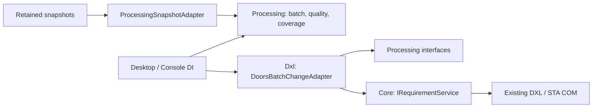

# Toplu işlem, kalite kuralları ve traceability coverage

Yeni JSON tabanlı RequirementsQualityRuleEngine, proje onaylı RuleProfile ve reviewer disposition ledger akışı [REQUIREMENTS-RULE-ENGINE.md](REQUIREMENTS-RULE-ENGINE.md) içinde açıklanır. Bu belgedeki XML QualityProfile ve XML batch gate geriye uyumlu kalır.

`DoorsIntegration.Processing`, .NET Framework 4.8 üzerinde DOORS'tan bağımsız toplu işlem ve analiz altyapısıdır. Assembly, **Core, COM, DXL veya IBM interop referansı taşımaz**. Hostlar DI ile adaptörleri bağlar. Gerçek DOORS'a yazma yalnız mevcut `RequirementService` üzerinden yapılır; yeni native API veya DXL yazma betiği eklenmedi. Geliştirme sırasında DOORS'a bağlanılmadı veya veri yazılmadı.

**Bulgular inceleme desteğidir. Bu yazılım DO-178C, DO-200B veya DO-330 uyumluluğu, sertifikasyon ya da araç kalifikasyonu sağlamaz/garanti etmez.** Bütün kalite raporlarında `ComplianceAssessed=false`, `ToolQualified=false` ve açıklama bulunur; coverage raporları da uyumluluk değerlendirmesi yapmadığını belirtir. Bir kanıt alanının dolu olması kanıtın doğruluğunu veya yeterliliğini ispatlamaz.

## Bağımlılıklar ve genişletme noktaları



| Port / tip | Görev |
| --- | --- |
| `IBatchRecordSource` | CSV/JSONL veya başka kaynaklardan kayıtları sırayla üretir |
| `BatchService` | capture, dry-run, onay, kayıt bazlı yürütme, rapor ve güvenli retry |
| `IBatchChangeAdapter` | Repository kontrolü, salt okunur inspection ve mutation kesinliğini bildiren yazma adaptörü |
| `IBatchChangeValidator` | Adaptöre gitmeden çalışabilen sürümlü ön kontrol; apply öncesi yeniden kontrol edilir |
| `IBatchJournal` / `IBatchJournalLease` | Kalıcı idempotency durumu ve kayıt anahtarının süreçler arası sahipliği |
| `IBatchAuditSink`, `IBatchConfirmation`, `IProcessingClock` | Audit, gerçek kullanıcı kararı ve test edilebilir UTC/bekleme |
| `IRequirementQualityRule`, `QualityProfile` | Adaptörden bağımsız kural ve yapılandırma fingerprint'i |
| `IQualityReportSink`, `ICoverageReportSink` | Belleğe bütün raporu almadan bulgu/kapsama çıktısı |
| `CoveragePolicy`, `TraceabilityCoverageService` | Açık ilişki/yön/sürüm politikasıyla coverage analizi |

İki host `TryAdd` kayıtları kullanır; validator/kural portları host tarafından genişletilebilir. Servis çözümleme ve ekran açma bağlantı kurmaz. `QualityEngine` stateless çalışır; özel kurallar deterministik olmalı, revision ve `ConfigurationFingerprint` gerçek kod/yapılandırmayı tanımlamalıdır. Paylaşılan özel kuralların thread safety'si eklentinin sorumluluğudur.

## Desktop kullanımı

**Workspace → Requirements** altında `Read`, `Batch import / update`, `Quality`, `Coverage` alt sekmeleri bulunur. Üst ana navigasyon ve sabit alt session şeridi korunur. Settings/watchdog ve ikon değiştirilmedi.

### Batch import / update

1. UTF-8 CSV/JSONL dosyası, **beklenen gerçek DOORS DatabaseId** ve kalıcı işlem namespace'i girin. DatabaseId, yetkili mevcut servis önizlemesinde görülen kimlikle aynı olmalıdır; bir profil/sürüm etiketi değildir.
2. Default 10.000 kayıt, anahtar başına toplam 3 deneme ve 120 saniye native çağrı beklemesi vardır. `Process valid records despite other failures` default kapalıdır. Açılması bağımsız geçerli kayıtların uygulanmasına izin verir; transaction/rollback sağlamaz.
3. `Preview / dry-run`, dosyayı bir kez yakalar; duplicate key ve aynı mevcut nesneye üst üste update durumlarında eşleşen **bütün** satırları engeller. Ardından native read-only doğrulamaları alır. Dosyanın sonradan değiştirilmesi yakalanmış isteği değiştirmez.
4. Grid 100 kayıt sayfalar. `Selected row details` önceki plain/raw-rich içerik, istenen değerler ve kontrol sorunlarını gösterir. Tam captured preview JSONL dosyasının yolu ve fingerprint görünür. Büyük sayfalar arka planda okunur.
5. `Review and apply...` önce batch niyetini onaylatır. **DOORS adaptörü her kayıt için yeni native dry-run ve ayrı açık kullanıcı onayı ister.** Batch onayı native kayıt onayını otomatik geçmez. Bu ilk adaptör toplu tek tıklamayla sessiz commit yapmaz.
6. Sonuçlarda kayıt anahtarı, dönen Absolute Number, attempt sayısı, durum, hata ve audit bilgisi görünür. `Failure CSV...` yerel raporu yeni dosyaya çıkarır. `Preview safe failed records` yalnız güvenle yeniden incelenebilen kayıtlar için yeni plan üretir; yeniden onay gerekir.

Her input/profile/connection değişimi planı geçersiz kılar. Plan aynı servis örneğine bağlı, 15 dakika geçerli ve tek kullanımlıktır. İlk preview'dan sonraki değişiklikler nedeniyle native kayıt önizlemesi yenilenir; **güncel** değerler kullanıcıya tekrar onaylatılır. DB, actor veya qualified hedef modül kimliği değişirse yazma onayına geçilmez. İzin/edit kilidi/attribute tipi/enum/required/hiyerarşi kontrolleri mevcut RequirementService içinde tekrar yapılır.

Import `Create` ve batch attribute `Update` destekler. Update mevcut Absolute Number ile çalışır ve hiyerarşiyi korur. Create mevcut anchor'a After/FirstChild/LastChild veya FirstInModule kullanabilir. Anchor mevcut nesnenin Absolute Number'ıdır; yeni satır anahtarından parent çözümlemesi bu adaptörde yoktur. İşlem sırası input sırasıdır; tekrarlanan FirstInModule veya aynı anchor'a After, native konumlandırma semantiğini izler ve sonradan eklenen nesne daha önce görünür. Dosya sırasının otomatik kardeş sırası olduğu varsayılmaz.

### Input sözleşmesi

Dağıtılan örnekler `scripts/samples/requirements-import.jsonl` ve `attribute-update.csv` içindedir. `/TEST/...`, anahtar ve nesne numaraları örnektir; yetkili test hedefinizle değiştirip preview alın.

```json
{"key":"external-001","action":"Create","target":"/Project/Requirements","attributes":[{"name":"Object Heading","value":"Heading"},{"name":"Object Text","value":"Requested text"}]}
{"key":"update-017-r2","action":"Update","target":"/Project/Requirements","objectId":"17","attributes":[{"name":"Priority","value":"High"}],"requiredAttributes":["Priority"]}
```

JSONL'de her fiziksel satır bir object'tir. `key`, `action`, `target`, `attributes` zorunludur; objectId/anchorId **string pozitif Absolute Number** olarak verilir. Opsiyonel `position`: Keep/FirstInModule/After/FirstChild/LastChild; `anchorId`; `requiredAttributes` dizisi. Attribute nesnesi `name`, `value` ve opsiyonel `format`/`expectedPlainText` taşır. PlainText default'tur. `OpaqueRichText` için DOORS raw rich/OLE temsili ve ayrıca beklenen plain text gerekir. Payload kod olarak değerlendirilmez; mevcut güvenli DXL escaping korunur. Bilinmeyen/duplicate JSON alanları, yanlış tipler ve bozuk kayıtlar reddedilir; eksik alanlar tahmin edilmez.

```csv
key,action,target,objectId,attr:Priority,attr:Object Text
update-017-r2,Update,/Project/Requirements,17,High,"Replacement text, including commas"
```

CSV header'ı key/action/target ve opsiyonel objectId/position/anchorId içerir. **Her attribute sütunu `attr:Tam Attribute Adı` biçimindedir.** Quoted virgül, çift tırnak ve çok satırlı alanlar korunur. Mevcut sütundaki boş hücre **boş değer atama** isteğidir; “dokunma” anlamına gelmez. Değişmeyecek alanın sütununu eklemeyin. CSV plain text assignment yapar; raw rich değişiklikleri JSONL üzerinden açık formatla verin. Plain replacement mevcut biçimlendirmeyi değiştirebilir; native review bunu gösterir.

Input UTF-8 (opsiyonel UTF-8 BOM), bozuk Unicode'da replacement yapmadan okunur. JSONL logical line üst sınırı 262.144 karakter; CSV record aynı toplam sınır, hücre başına 65.536 karakter ve 40 sütun sınırındadır. Bir değişiklik en çok 32 attribute taşır. Native adaptörün daha dar toplam payload/type sınırları ayrıca geçerlidir. Captured input + preview toplam disk sınırı default 256 MiB, en çok 1 GiB'dir. Kaynak/transport veya capture limiti hatasında eksik plan çalıştırılmaz. Tüm kayıtlar bellekte biriktirilmez; duplicate anahtar indeksleri kayıt limitiyle sınırlıdır.

### Kalıcı idempotency, audit ve retry

Varsayılan kök `%LOCALAPPDATA%\DoorsIntegration\processing`:

- `plans/<job>/captured.jsonl`, `preview.jsonl`: immutable captured veri ve inceleme bilgisi; canlı preview lease'i dosya değişimini engeller.
- `journal/<hash>.lock`, `<hash>.jsonl`: `{repositoryId, operationNamespace, record.key}` için süreçler arası exclusive lease ve durable state.
- `audit.jsonl`: UTC, job/record/key, repository/namespace, action/hedef/nesne, actor/qualified hedef kimliği, payload/review fingerprint, onay/attempt/sonuç/belirsizlik olayları. Requirement içerikleri otomatik audit'e yazılmaz.
- `reports/<job>/rows.jsonl`, `failures.jsonl`, `summary.json`: Applied/AlreadyApplied/Blocked/Conflict/Failed/Unknown/PartialFailure/AppliedWithProblems/Cancelled/NotAttempted sonuçları.

Normalized payload SHA-256 attribute listesi ile required listesi sınırlarını da bağlar. Aynı anahtar + farklı içerik `IdempotencyPayloadConflict` olur; önceki delil ezilmez. `AlreadyApplied`, aynı journal'daki **önceden doğrulanmış tarihsel** sonucu ve nesne kimliğini döndürür; DOORS'un bugün değişmemiş olduğunu kanıtlamaz veya yeniden okuma yapmaz. Yeni bir değişiklik yeni incelenmiş işlem revizyonudur; Unknown kayıtlar yeni ad/namespace verilerek atlanmamalıdır.

Native çağrıdan **önce** Started satırı durable flush edilir. Crash sonrasında Started/Unknown/Partial/AppliedWithProblems kayıtları yeniden gönderilmez; manuel reconciliation gerekir. “Create DB'de oldu, journal terminal kaydı yazılamadı” aralığı Unknown olarak korunur. DB transaction'ı veya dağıtık exactly-once garantisi yoktur. Aynı journal kökünü kullanan süreçlerde anahtar replay'i engellenir; ayrı kullanıcı/makine/journal kökleri aynı idempotency deposu değildir. Ortak çok makine koordinasyonu gerekiyorsa merkezi transactional `IBatchJournal` adaptörü gerekir.

Otomatik retry yalnız adaptörün **hiç mutation olmadığını kesin bildirdiği geçici hata** içindir. Default 3, en çok 5 toplam attempt anahtarın bütün yaşamı boyunca geçerlidir; backoff 200/400/... ms, en çok 5 saniyedir. Approval reddi, validation/context hataları otomatik retry edilmez. Güvenli no-mutation başarısızlıkları yeni preview/onayla elle tekrar değerlendirilebilir; input hatası düzeltilmiş dosyayla yeniden preview gerektirir.

COM timeout/iptal fiziksel çağrıyı kesmez. Original completion varsa journal lease'i tutulur, geç sonuç gözlenir ve kalan batch durdurulur; otomatik resubmit/rollback yoktur. Bekleme COM dönene kadar sürebilir. Geç sonuç hâlâ Unknown olabilir. Native outcome doğrulanamıyorsa journal koruması kalkmaz. Audit veya journal pre-dispatch hatası yeni yazmayı engeller; post-dispatch hata mutation'ı geri almış sayılmaz. Saved/AuditFailed veya dirty partial modül tekrar create/update edilmez. Eksik/bozuk journal/audit son satırı otomatik düzeltilmez, silinmez veya sıfırlanmaz.

Failure CSV UTF-8 BOM, quoting ve baştaki whitespace sonrası `= + - @` gibi formula hücreleri için apostrof koruması kullanır. Mevcut rapor dosyasının üzerine yazılmaz. Input değerleri formül olarak çalıştırılmaz; import metni sessizce değiştirilmez.

## Bağımsız kalite kural motoru

Quality, retained requirements üzerinde offline çalışır. XML profili seçin, repository bağını ve baseline kullanılıyorsa **Links metadata'sından doğrulanmış tam native baseline etiketini** girin. Profilin özel attribute alanlarını önce Read ekranında isteyin. Okunmayan, yetkisiz, çok büyük veya yüklenmemiş alanlar boş değer varsayılmadan `NotEvaluated` döner. Readable ama boş bir required alan `Finding` üretir.

Yerleşik konfigüre edilebilir kurallar:

| Kind | İnceleme yardımı |
| --- | --- |
| RequiredAny / RequiredAll | Yapılandırılmış içerik veya kanıt alanlarının doluluğu |
| PatternAbsent | Kuruma/dile özel belirsiz ifade/desen kontrolü; regex 100 ms timeout, en çok 512 karakter |
| Enumeration | Açık izin verilen metin değerleri |
| NumericRange | Invariant decimal ve onaylı proje aralığı; otomatik birim dönüşümü yok |
| UtcDate / Freshness | Açık `...Z` UTC timestamp ve konfigüre edilmiş yaş sınırı |

Profil dosyaları `scripts/quality` içindedir. `requirements-quality.example.xml` basit içerik/desen yardımıdır; `do178c-review.example.xml`, `do200b-review.example.xml`, `do330-review.example.xml` **örnek organizasyon inceleme profilleridir**, normatif madde/objective kataloğu değildir. DO-200B numeric/freshness eşikleri özellikle boş bırakıldı: onaylı DQR değerleri verilmeden NotConfigured/NotEvaluated oluşur. DO-330 kanıt alanlarının varlığını incelemek, bu yazılımı veya başka bir aracı qualify etmez.

```xml
<qualityProfile id="org-requirement-review" revision="2" exampleOnly="false">
  <rule id="ORG-REQ-17" revision="3" severity="Warning" kind="RequiredAll"
        standardContext="DO-178C" projectReference="Approved-project-checklist-17">
    <field>Verification Method</field>
  </rule>
</qualityProfile>
```

Field mapping, allowed değerleri, aralıklar, freshness ve projectReference kuruluşunuzun onaylı planlarından gelmelidir. `exampleOnly=false` de uyumluluk/kalifikasyon anlamına gelmez. XML parser DTD/external entity ve bilinmeyen eleman/attribute'ları reddeder. Profile ID/revision, kural ID/revision ve gerçek ayarlar fingerprint ile bağlanır. Özel `IRequirementQualityRule` implementasyonları yeni kurallar ekler; `QualityBatchValidator` aynı bağımsız profili import ön kontrolüne bağlayabilir. Gate, Error bulgularında; default olarak da NotEvaluated/RuleError'da adaptöre gitmeden engeller. Update payload'ı yalnız değişecek alanları içerdiğinden tam mevcut kayıt kanıtı varsayılmaz. Validator policy fingerprint'i plana bağlıdır ve apply öncesinde yeniden kontrol edilir.

`QualityEngine.Evaluate` kaynak ve rule sonuçlarını sırayla işler. Bir özel kuralın hatası `RuleError` olur; ham exception veya requirement metni rapora/loga konmaz. Diğer kurallar çalışabilir, fakat sonuç FullyEvaluated olmaz. Deleted, unknown version, duplicate identity, eksik kaynak, iptal ve limitler raporda kalır. `FullyEvaluated` yalnız tanımlı kapsamda bütün konfigüre edilmiş kontrollerin çalışmasıdır; Findings sıfır veya standartlar sağlandı demek değildir.

`observations.jsonl` + `summary.json`: input hash, artifact/version kimliği, profile/rule revision/fingerprint, severity, Passed/Finding/NotEvaluated/RuleError, kaynak kapsamı, UTC zaman ve disclosure tutulur. Opaque rich/OLE veri modelde korunur, otomatik render/evaluation yapılmaz; metin kuralları plain temsili inceler. Native requirement içerikleri kalite raporuna kopyalanmaz. Default en çok 100.000 artifact, kural başına 65.536 karakter; disk raporu 256 MiB'dir. Limitli/yarım sonuç başarıya çevrilmez; disk sınırı hatasında tamamlanmış summary yayımlanmaz.

## Traceability coverage

Coverage ekranı eşleşen Requirements ve Links snapshot'ları kullanır. Anchor modül ve baseline aynı, okunmuş link yönü istenen yönde olmalıdır. İlişki tek tam link module yoludur. Politika incoming/outgoing, minimum farklı karşı uç, izin verilen karşı modüller ve SameVersion/CurrentTarget/AnyExplicitVersion içerir. Çoklu politikalar API'den eklenebilir.

Kimlik `{repository, container, object, Current/Baseline, version}` bileşimidir. Aynı Absolute Number'a sahip current/baseline nesneler birleşmez. Echoed, silinmiş veya unresolved uçlar doğrulanmış coverage sayılmaz. Aynı physical edge'in incoming/outgoing tekrar gözlemi tek sayılır; duplicate linkler minimum farklı karşı uç sayısını artırmaz.

- **Covered**: yapılandırılmış minimum sayıda doğrulanmış ilişki gözlendi.
- **Uncovered**: yalnız kaynak kapsamı tam olduğunda eksik ilişki kesin olarak raporlanabilir.
- **Unknown**: izin/çözümleme/okuma/kapsam/limit sorunu yüzünden eksiklik kanıtlanamıyor.
- **Excluded**: silinmiş anchor nesnesi kapsam dışında tutuldu.

Processing offline eşlemesi **caller-bound repository + tam yol kimlikleri** kullanır; legacy snapshot'larda native DatabaseId/qualified module ID yoktur. Yeni Requirement v2 çıktısı qualified module ID taşısa da mevcut Processing/Link eşlemesi bunu kendiliğinden ortak native kimliğe dönüştürmez. Repository/versiyonun aynı olduğunu ayrıca doğrulamadan UI'daki attestation kutusunu seçmeyin; default kapalıdır ve tam yüzde üretilmez. Baseline'ın tam native etiket biçimi tahmin edilmez; doğrulanmış etiket verilmezse kimlik Unknown kalır. Snapshot'lar farklı zamanlarda alınır ve atomic DB görüntüsü değildir.

`CoveragePercent` yalnız tam kapsam, bilinen population, en az bir policy ve sıfır Unknown varsa hesaplanır; boş/kısmi kapsam için null'dır. Covered/Uncovered/Unknown/Excluded sayıları **artifact × policy** gözlemleridir. Default 100.000 node kimliği + 250.000 relation üst sınırı vardır; edge'ler streaming, kimlik/dedup indeksleri bounded bellekte tutulur. Rapor `coverage.jsonl` + `summary.json`; default disk sınırı 256 MiB'dir. Kapsama yüzdesi yalnız seçili politika/kapsamı anlatır; requirement doğruluğunu, verification yeterliliğini veya standarda uygunluğu göstermez.

## API örnekleri

```csharp
// Console iki onay seviyesinde de default deny kullanır. Host gerçek kullanıcı review portlarını sağlamalıdır.
var batch = provider.GetRequiredService<BatchService>();
using (var preview = await batch.PreviewAsync(
    new CsvBatchSource(inputPath), new BatchOptions(expectedDatabaseId, stableNamespace), token, progress))
{
    foreach (var row in preview.ReadRows()) ShowRow(row); // streaming inceleme
    if (preview.CanApply)
    {
        var report = await batch.ApplyAsync(preview, token, progress);
        foreach (var result in report.ReadRows()) ShowResult(result);
        // Gerekirse batch.PreviewRetryAsync(preview, report, token) → ayrı yeni review/apply.
    }
}

var profile = QualityProfile.LoadXml(profilePath);
using (var report = new FileQualityReport(newOutputDirectory))
    qualityEngine.Evaluate(neutralArtifacts, profile,
        new QualityContext(sourceDescription, sourceComplete, DateTime.UtcNow), report, token);

using (var report = new FileCoverageReport(anotherNewDirectory))
    coverageService.Analyze(neutralNodes, neutralRelations, coveragePolicies,
        new CoverageContext(repositoryId, sourceComplete, sourceDescription), report, token);
```

provider, dosya yolları, snapshot kaynağı, sourceComplete kanıtı, ShowRow/ShowResult, token ve progress hosta aittir. `DoorsBatchServiceFactory.Create(version, connectionMode, timeout)` Desktop gibi değişebilir profiller için immutable adaptör bağlamı yakalar. `ProcessingSnapshotAdapter` retained kaynakları neutral modellere dönüştürür; yeniden COM çağırmaz. Gereken global uniqueness/reconciliation veya daha büyük disk-backed graph indeksleri portlarla genişletilebilir; varsayılan dosya deposu bu garantileri bütün veritabanına yaymaz.

## Standart bağlamı ve kabul testleri

FAA [AC 20-115D](https://www.faa.gov/airports/resources/advisory_circulars/index.cfm/go/document.information/documentNumber/20-115D), DO-178C ve DO-330'u kabul edilen rehber bağlamında tanır; burada dağıtılan profiller bu dokümanların yerine geçmez. FAA [AC 20-153B](https://www.faa.gov/documentLibrary/media/Advisory_Circular/AC_20-153B.pdf), aeronautical data süreçleri ve DO-200B/DQR bağlamını ele alır. Tam normatif metinler bu uygulamaya gömülmedi; standard clause/assurance level/qualification kararı tahmin edilmez. Onaylı proje planları, lisanslı standartlar, uzman incelemesi ve gerekli bağımsız kanıtlar ayrıca değerlendirilmelidir.

DOORS 9.5/9.7 × uygun x86/x64 test DB'sinde, gerçek veriye geçmeden:

1. Bütün yeni sekmeler ve analizler offline kalmalı; Quality/Coverage retained snapshot dışında okumamalı.
2. UTF-8/quoted multiline CSV, boş assignment, plain/rich JSONL, yanlış schema/enum/required, erişim/kilit, yanlış DB/actor ve aynı hedefe çift update preview'ı doğrulanmalı.
3. Batch ve native kayıt onaylarının her birini reddedin; özellikle ikinci kayıt reddinde ilk Applied, ikinci Failed, kalanlar NotAttempted/Continue politikasına uygun görünmeli.
4. İki onaylı create ve iki update'i save/reopen ile karşılaştırın; ID/konum/değerleri doğrulayın. Aynı namespace/key ile yeniden açılan uygulama yeni nesne üretmemeli. Payload değişince conflict olmalı.
5. Source input değiştirme, plan expiry, process crash, incomplete audit/journal tail, late COM sonucu ve disk hatasında yeni mutation/retry otomatik başlamamalı; dirty modül delili korunmalı.
6. Yalnız safe failed kayıtları yeni preview ile yeniden deneyin. Unknown/partial/SavedWithProblems kayıtları retry seçimine girmemeli. Aynı paylaşılan journal anahtarı iki süreçte eşzamanlı dispatch edilememeli.
7. XML rule mapping/threshold/revision değişimleri, custom rule hatası, regex timeout, unavailable/deleted/large alanlar ve kaynak limiti test edilmeli; rapor disclosure ve metadata'sı korunmalı.
8. Current/baseline, incoming/outgoing, duplicate/unresolved/echoed/denied linkler ve incomplete population denenmeli; Unknown varken tam yüzde veya standard compliance sonucu üretilmemeli.

Default testlerde `DOORS_TEST_MODE=disabled` kullanılır. Yeni managed testler gerçek file store/WinForms/transport ile fake native portlar kullanır; **native DOORS 9.5/9.7 execution, locking, schema ve persistence uyumluluğunu kanıtlamaz**. Build komutları README'dedir; yeni paket/NuGet bağımlılığı eklenmeden framework serialization/XML kullanıldı.
