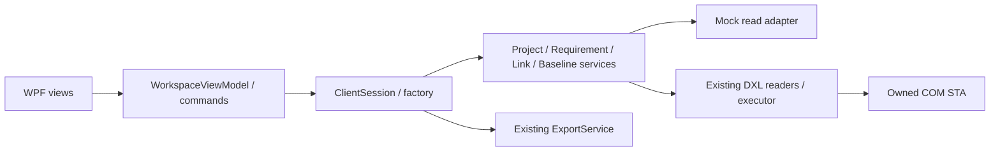

# WPF istemcisi

Task 25: **Bulk Baseline Manager**, dokuzuncu ana sekmedir. Çoklu klasör/formal module seçimi, preflight + kesin onay, Task 24 progress/cancel/history/reconcile ve JSON/CSV export tek ekrandadır. Mock uçtan uca çalışır; Real yazması mevcut native doğrulamalar tamamlanmadan açılmaz. [Akış ve UI/MVVM kanıtı](WPF-BULK-BASELINE-MANAGER.md). Önceki sekmeler korunmuştur.

Task 22: **Bulk baseline / Dry run**, Task 20 seçimlerinden read-only ön kontrol ve fresh revalidation çalıştırır. Major/Minor, suffix, annotation ve execution policy seçilebilir; satırlarda durum/neden/uyarı/çözüm, detayda fingerprint gösterilir. Ready hiçbir yazma yetkisi vermez. [Akış ve native doğrulama sınırları](BULK-BASELINE-PREFLIGHT.md).

Task 21: `ClientSession.BaselineMetadata` mevcut seçili modül referanslarından WPF'ye bind edilebilir history/proposal/collision DTO'ları döndürür. Yeni sekme eklenmez. Native 9.5 API / nextMajor-nextMinor çözümlemesi doğrulanmadığında açık durum ve null ExpectedVersion döner. [API ve doğrulama sınırları](BASELINE-METADATA.md).

Task 20: son sekmedeki **Bulk baseline / Modül seçimi**, birden fazla proje/klasör için bağımsız IncludeSubfolders, lazy yükleme/cancellation, kimlik bazlı seçim, filtreler ve yerel JSON profilleri sunar. [Kullanım ve read-only sınırları](MODULE-SELECTION.md). Task 19 plan önizlemesi NOT_RUN kalır; gerçek baseline oluşturulmaz.

`DoorsIntegration.Wpf`, **birleşik Windows masaüstü uygulamasıdır** (.NET Framework 4.8 / MVVM). Başlangıç kaynağı **Mock**, çalışma modu **salt okunur**dur. Mock açılışı örnek ağaç ve modülü yükler; Real DOORS seçimi tek başına COM bağlantısı kurmaz. Okuma, onaylı yazma, batch, analiz, export, DXL, smoke suite ve Settings tek pencerededir. DWA/OSLC/HTTP kullanılmaz. [Yeni işlem ekranları ve güvenlik akışları](UNIFIED-DESKTOP.md).

## Çalıştırma / build

Windows ve .NET Framework 4.8 gerekir. Office kurulumu gerekmez. Mevcut SDK/NuGet yapılandırması kullanılır; yeni UI/MVVM veya graph NuGet bağımlılığı eklenmemiştir.

```powershell
$env:DOTNET_CLI_HOME = Join-Path (Get-Location) '.cli'
$env:DOORS_TEST_MODE = 'disabled'
dotnet restore DoorsIntegration.sln -p:Platform=x64 --packages .packages --configfile NuGet.Config
dotnet build DoorsIntegration.sln -c Release -p:Platform=x64 --no-restore
dotnet test tests/DoorsIntegration.Tests/DoorsIntegration.Tests.csproj -c Release -p:Platform=x64 --no-build --no-restore --settings tests.runsettings -- RunConfiguration.TargetPlatform=x64
```

x86 için platform ve test TargetPlatform değerlerini birlikte `x86` yapın; platform değişiminde restore'u tekrarlayın. Visual Studio'da `DoorsIntegration.Wpf` başlangıç projesi seçilebilir. EXE yolları:

- `src/DoorsIntegration.Wpf/bin/x86/Release/net48/DoorsIntegration.Wpf.exe`
- `src/DoorsIntegration.Wpf/bin/x64/Release/net48/DoorsIntegration.Wpf.exe`

Güncel tek masaüstü dağıtımı `artifacts/releases/current/DoorsIntegration-Wpf-x86.zip` ve `DoorsIntegration-Wpf-x64.zip` dosyalarıdır. ZIP'in tamamını çıkarıp `DoorsIntegration.Wpf.exe` veya `DoorsIntegration.cmd` açın. `scripts/Package-Wpf.ps1 -Platform x64 -SkipBuild` (veya x86) bu paketleri üretir. Desktop alias paketleri ve eski WinForms projesi [arşive taşınmıştır](../archive/WinForms/README.md); ana solution bunlara bağımlı değildir. EXE, config, DLL ve scripts klasörünü birlikte tutun. Paketleme test başlatmaz.

## Ekranlar

**Workspace** üç panellidir: solda proje/klasör/modül ağacı, ortada gereksinimler, sağda attribute ve link detayları. Ayırıcılar sürüklenebilir. Tam kök yolu ile **Ağacı keşfet** komutu mevcut `ProjectService` üzerinden hiyerarşiyi okur. Tür/erişim durumu her düğümde görünür. Formal modül seçimi veya tam modül yolu + **Oku**, `RequirementService` aracılığıyla current sürümü salt okunur okur. Özel attribute adları virgül/noktalı virgül/satır sonuyla ayrılır; Object Heading/Text daima vardır. Adların native attribute'larla tam eşleşmesi gerekir.

Liste **100 satır / sayfa** gösterir. Arama identifier, görüntü numarası ve okunabilir plain attribute değerlerinde, **snapshot'ın tamamında** case-insensitive substring aramasıdır; regex değildir. En çok 256 karakter kabul edilir. **Ara**, değişen filtre/arama koşullarını uygular; yalnız yazmak tarama başlatmaz. Active/Deleted/All filtresi ve ileri/geri sayfalama vardır. Bütün gövdeler bellekte biriktirilmez: UI yalnız kısa liste projeksiyonlarını ve seçili nesnenin kısaltılmış ayrıntısını tutar; native dosya snapshot'ı retained kalır. Deleted nesneler metadata-only okunur. Okunamayan içerik boş/başarılı veri kabul edilmez; erişim durumları gösterilir.

Nesne seçimi sağ panelde alan adlarını, tipleri, plain erişim durumunu ve seçilen alanın plain/opaque rich değerini açar. Uzun görünüm değerleri 16.384 karakterde, liste özetleri daha kısa kesilir; kesinti mesajı görünür ve tam değerler export'ta kalır. RTF/OLE **çalıştırılmaz veya render edilmez**. Links alt sekmesi, daha önce okunan tam link snapshot'ından seçili modül/Absolute Number ile en çok 100 ilgili satırı gösterir. Link kapsamı okunduktan sonra nesneyi yeniden seçin.

**Baseline diff**, aynı modülün iki mevcut baseline'ını `BaselineComparisonService` ile karşılaştırır. Major/minor/suffix ayrı girilir. Varsayılan plain policy NFC + satır sonları; `Plain text: exact` ham karşılaştırmadır. Rich karşılaştırma opaque/birebirdir. Added/Deleted/Modified/Unchanged/Indeterminate, conclusive bayrağı, attribute farkları ve 100 satırlık sayfalar gösterilir. Nesne seçimi önce/sonra alan değerlerini ve fark bayraklarını açar. Kimlik olarak qualified module ID + Absolute Number kullanılır; görünen Object Number eşleştirme anahtarı olmaz. Baseline girdisi/normalizasyon/özel alan/modül/profil değişince eski diff geçersiz kılınır. [Servis kapsamı ve sınırlamalar](BASELINE-COMPARISON.md).

**Traceability graph**, seçili modül ve **tam link module yolu** için mevcut `LinkService` okumasını kullanır. Varsayılan current/Both olup İşlemler → Okuma / keşif ayarları ile baseline, yön, resolution, surrogate ve limitler seçilebilir. Source→Target yönlü ilişki diyagramında en çok **150 kayıt** gösterilir; retained snapshot ve export bu görsel sınırla kesilmez. Mavi çizgi çözülmüş gerçek linki, kesikli sarı çizgi unresolved/referans/echo/erişim kısıtını ayırır. İlişkiye tıklama kaynak/hedef modül, versiyon, Absolute Number, link module, resolution ve surrogate durumlarını gösterir. Her ilişki bir kaynak-hedef çifti olarak çizilir; ortak uçlar tek global node'da birleştirilmez. Bu grafik bütün veritabanı, tamamlanmış coverage veya downstream etki analizi değildir. Partial scope bilgisi, unresolved ve incoming reference sayaçları saklanır.

**Connection diagnostics** üstteki Offline diagnostics veya Ping komutunun sonucunu ayrı sekmede gösterir. Offline gerçek COM kayıt görünümlerini ve binary metadatasını okur; bağlanmaz. Ping, ComRegistration, ClientVersion, ComConnection, DxlExecution, DxlResponse ve ComCleanup adımlarını ayrı raporlar. Hata kodu ve açıklamalar merkezi Core sözleşmelerinden gelir. Mock tanılama açıkça **simülasyon** olarak işaretlenir; gerçek kayıt/istemci doğrulaması sayılmaz. Kayıtlı binary sürümü çalışan client sürümüne ilişkin kesin kanıt değildir.

**Export**, Workspace (retained discovery/requirements/links), Requirements, Links veya ayrıca **BaselineDiff** kapsamını JSON/CSV/XLSX olarak mevcut `ExportService` ile aktarır. Uygun kaynak yoksa komut kapalıdır. Sayfa/arama filtresi export kapsamını küçültmez. Çıktı kökünün altında her çalışmada yeni benzersiz alt klasör oluşturulur; mevcut çıktı değiştirilmez. Payload yanında `report.json`, durum, sayaçlar, sorunlar ve son klasör yolu gösterilir. CSV injection koruması, Unicode, UTC tarih, null/boş ayrımı, uzun rich/plain için ValueChunks ve hata/iptalde tamamlanmamış payload yayımlamama ortak export sözleşmesinden gelir. Export yayınlandıktan sonra geç gelen iptal tamamlanmış dosyayı geri almaz; raporun gerçek durumu gösterilir. [Export rehberi](EXPORT.md).

## MVVM, threading ve iptal

`WorkspaceViewModel`, `ObservableModel` ve await edilebilir `UiCommand` INPC/ICommand uygular. `MainWindow` code-behind yalnız TreeView/DataGrid seçimlerini komutlara aktarır, graph seçim detayını bağlar ve pencere ömrünü yönetir. `IClientSessionFactory` constructor injection noktasıdır; test/başka host kendi servis bileşimini sağlayabilir. `ClientSession` Core servislerini kapsar. WPF uygulaması Console/WinForms EXE'sine referans vermez. Koyu mavi tema ayrı `Themes/Dark.xaml` resource dictionary içindedir.



Bütün servis çağrıları, dosya enumeration'ı, arama, sayfa ve graph/diff projeksiyonları `Task.Run` üzerinden WPF dispatcher dışında başlatılır. Async native reader'lar mevcut executor'ün sahip olduğu COM STA'sını kullanır. Senkron `DoorsHealthChecks` ayrı bir STA thread'de çağrılır; UI STA'sında COM oturumu açılmaz. UI listeleri/status/progress yalnız yakalanan dispatcher context'inde değiştirilir. View model bir UI synchronization context'inde oluşturulmalı ve UI komutları bu context'ten çağrılmalıdır.

Tek işlem çalışır. İşlem sırasında profil ve veri girdileri, çakışan komutlar kapalı; **İptal iste** açık kalır. Native servislerin yüzde bilgisi yokken progress indeterminate'dır; export aşama/record/issue sayaçları gösterilir. İptal kooperatiftir; başlamış COM çağrısı güvenli şekilde zorla durdurulamaz. Native wait iptali/timeout sonrasında da orijinal executor Completion/cleanup bitene kadar busy ve paylaşılan gate korunur; yeni işlem ve profil geçişi açılmaz, otomatik retry yapılmaz. Senkron ping'in iptali de orijinal STA çağrısından erken dönmez. Bazı native işlemlerin tamamlanması kullanıcı etkileşimi gerektirebilir.

Pencere kapatılırken iptal istenir, idle/drain beklenir, ardından yerel snapshot ve comparison lease'leri temizlenir. Aktif native işlem sürerken zorla COM release/Abort yapılmaz. Profil değişimi discovery/requirements/links/diff/diagnostics ve graph seçimini temizler; modül/özel alan/link yolu/baseline değişimleri ilgili retained sonuçları geçersiz kılar. Yerel dosya cleanup hataları, eski kanıtın görünümde kalmasına veya yeni lease'in kaybolmasına yol açmadan metadata-only log ve hata alanında raporlanır. Dosya izin hatasında yerel geçici dosya kalabilir; recursive cleanup yapılmaz.

## Salt okunur / onay politikası

**Salt okunur mod** varsayılan açıktır. Kapatmak yalnız Real DOORS modunda yazma komutlarını kullanılabilir yapar; kaydedilmiş onay değildir. Mod değişiminde önizlemeler, profil/connection değişiminde ayrıca salt okunur başlangıç geri yüklenir. Modül, gereksinim ve link için fresh dry-run + tam hedef yazımı + acknowledgement gerekir. Remove ayrı `DELETE <tam hedef>` onayı ister. Batch önce captured intent, sonra her kayıt için fresh native onay ister. Input değişiminde plan geçersizleşir; commit planı tüketir. İptal, kapatma, görünmeyen owner, expiry ve hedef uyuşmazlığı onay değildir. Native audit, kimlik/izin/kilit/tip/enum kontrolleri mevcut servislerde korunur. Belirsiz veya kısmi yazma tekrar edilmez. Mock yazma gerçekleştirmez. Onay sağlayıcısız factory/test bileşimi read-only kalır; otomatik onaylayıcı yoktur.

`AllowAttributeDxl=false` varsayılandır. İşlemler → Okuma / keşif ayarları alanından açılırsa Real DOORS + yazma modu + ayrıca açık native kod yürütme onayı gerekir; kurulu attribute DXL'in etkileri varsayılmaz. Genel DXL yalnız incelenmiş captured kaynak ile ve ayrı onayla yürütülür. Real mode varsayılanı `AttachExisting`tir; `Activate` ancak kullanıcı o bağlantı modunu seçip native bir komut başlatırsa client'ı başlatabilir. Smoke her zaman AttachExisting kullanır. Settings mevcut `settings.xml` şemasını ve watchdog tercihini paylaşır; yalnız Kaydet tercihi değiştirir. Eski double-app-wait checkbox geri getirilmemiştir.

## Mock örnekleri ve kabul testleri

Mock'ta `/Demo/Flight requirements` ve `/Demo/Verification/Test cases` okunabilir; `/Demo/Restricted` erişim reddi örneğidir. Link module `/Demo/Verification links`tir. 240 nesne, current görünümde bir metadata-only deleted nesne, Status alanı, 24 link (biri erişilemeyen hedef) vardır. `1.0[A] → 2.0[B]` örneği Added/Deleted/Modified/Unchanged sonuçları üretir. Bu yerel adapter örnek veridir; gerçek baseline listesi keşfetmez veya native sürüm desteğini kanıtlamaz.

Managed testler gerçek Core/export motoru, ayrı WPF dispatcher/STA ve mock read portları kullanır. Şunları doğrular: default Mock/read-only/no-native, ağaç erişim bilgisi, global search/100'lük paging/deleted filtre, attribute/raw-rich/link ayrıntısı, unresolved graph, gerçek Core baseline farkları, cache invalidation, dispatcher dışında service invocation ve UI property notification, ayrı diagnostic STA, iptal+native drain+close beklemesi, full snapshot export/formatlar/baseline source, safe missing scope, merkezi hatalar ve write guard. Pencerenin beş sekmesi gerçek WPF layout ile render edilir; binding hataları test başarısızlığıdır. Görseller `artifacts/WpfClient/<x86|x64>` içindedir.

Manuel kontrol:

1. ZIP'ten açın; Mock tree/current list otomatik gelsin. Tree splitters, scroll, klavye tab/focus, uzun Unicode başlıklar ve 100/125/150/200% DPI'da 1120×760 ve daha büyük pencereyi sınayın.
2. Sayfa değiştirip son sayfadaki bir nesneyi global arayın; Deleted/All, ham RTF, related link ve kısıtlı modül mesajlarını kontrol edin.
3. Baseline girdilerini/normalizasyonu değiştirince eski diff/export kapansın. Graph unresolved çizgileri ve referansların tam çözülmüş edge gibi sayılmadığını doğrulayın.
4. Her export formatını açın; yalnız sayfanın değil tam snapshot'ın taşındığını, JSON/XLSX chunk geri kurmasını ve Excel'de metin/formül ayrımını kontrol edin.
5. Uzun işlemde Cancel, profil geçişi ve pencere kapatma deneyin; UI yanıt vermeli, orijinal COM/cleanup bitmeden yeni native komut gönderilmemeli.
6. Real için zaten mevcut onaylı salt okunur test verisi kullanın. 9.5 ve 9.7, desteklenen x86/x64 COM kayıt mimarilerinde offline diagnostics ve ping'i çalıştırın; path/attribute/link/baseline alanlarını gerçek değerlerle doldurun. Sahte/mock verinin Real sonucu gibi korunmadığını doğrulayın.

Bu geliştirmede gerçek DOORS'a bağlanılmadı; veritabanı değiştirilmedi. Native 9.5/9.7, kurulu attribute/open-trigger davranışı, gerçek Excel UI ve yüksek DPI saha doğrulaması manuel kabulde kalır. Managed mock testleri standart uyumluluğu veya araç kalifikasyonu garantisi değildir.

## JSON requirements rule engine

İşlemler & Settings → Kalite kontrolü artık XML yanında yeni JSON RuleProfile akışını sunar. Project ID, ApprovedProfileOnly/DraftPreview ve General/DO178C/DO200B/DO330 seçilebilir. Örnek JSON dosyaları taslaktır; alan/link module eşlemeleri yapılandırılmadan onaylanamaz. Proje profilini incele ve onayla düğmesi exact fingerprint + acknowledgement ister ve yeni yerel JSON dosyası yazar; Mock/read-only modunu veya native write izinlerini değiştirmez. Analiz retained requirement/link snapshot'larını kullanır; COM çağrısı yapmaz. Kanıt, öneri ve Pending disposition results.jsonl içindedir; API review ledger daha sonra exact matching sonucu insan kararıyla birleştirir. Ayrıntılı kullanım: [REQUIREMENTS-RULE-ENGINE.md](REQUIREMENTS-RULE-ENGINE.md). WinForms XML quality ekranı ve XML batch gate geriye uyumlu kalır.
